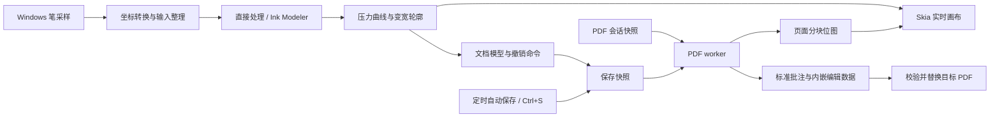

# Naive Note：Skia＋MuPDF 本地 PDF 手写笔记方案

## 一、目标与技术路线

在当前 `naive-note` 仓库中构建独立的 Windows 桌面应用，先完成：

**打开 PDF → 压感书写 → 撤销重做 → 保存标准批注 → 其他阅读器显示 → 本应用重开继续书写。**

已确定的产品行为：

- **本地运行**：文档、设置、恢复数据保存在本机，应用运行无需服务器或账号。
- **PDF 是主文件**：分享文档时携带一个 PDF 即可。
- **平滑默认开启**：使用 `ink-stroke-modeler-rs`，通过运行时开关关闭；不设置编译 feature gate。
- **定时自动保存＋手动保存**：默认每 10 秒检查并保存有变化的文档，间隔可设为 5–15 秒；保留 Ctrl+S，不再实现逐笔恢复日志。步骤 9 已接入运行时代码，人工验收待完成。
- **首版先闭合书写链路**：初期暂缓扩展工具；2026-11-10 已按后续需求接入对象橡皮擦、矩形 / 套索选择与清除、选中笔迹移动和旋转、压感荧光笔。文字图片编辑、图层和无限画布仍未接入。

建议固定以下依赖基线，并提交 `Cargo.lock`：

| 职责                 | 首版方案                                 |
| -------------------- | ---------------------------------------- |
| Windows 构建         | Rust MSVC，`x86_64-pc-windows-msvc`      |
| 窗口与事件循环       | `winit 0.30.13`                          |
| OpenGL 上下文        | `glutin 0.32.3`＋`glutin-winit 0.5.0`    |
| 工具栏、设置、对话框 | `egui / egui-winit / egui_glow 0.37.0`   |
| 实时画布             | `skia-safe 0.157.0`，Ganesh OpenGL 后端  |
| 原生笔输入           | crates.io `tablet-input-windows` 1.0.0    |
| 可选笔迹建模         | `ink-stroke-modeler-rs 0.1.0`            |
| PDF 渲染和批注保存   | `mupdf 0.8.0`＋内置 MuPDF 1.27.2；标准批注、附件及正式保存已接入，人工验收待完成 |

这些版本来自当前发布文档；egui 与 Skia 均有 glutin 接入示例，可作为集成起点。**共用上下文的代码已接入并通过编译，用户已确认空白窗口和 egui 文字显示正常；完整交互与绘制兼容性仍需继续验收。** [egui_glow](https://docs.rs/crate/egui_glow/0.37.0)、[skia-safe](https://docs.rs/crate/skia-safe/0.157.0)、[Skia OpenGL 示例](https://github.com/rust-skia/rust-skia/blob/master/skia-safe/examples/gl-window/main.rs)

Skia 首版关闭默认 features，开启 `binary-cache`、`gl` 和 `pdf`。0.157.0 的 Windows 预编译产物没有独立的 `ganesh-gl` 组合，需启用 `pdf` 匹配上游已发布的 `ganesh-gl-jpegd-jpege-pdf` 包；这不改变 MuPDF 负责已有 PDF 读取和批注保存的分工。画布文字加入时再启用 `textlayout`，避免第一阶段同时处理文字排版和 ICU。这里使用完整 Skia 引擎，按需选择编译模块。[官方预编译产物](https://github.com/rust-skia/skia-binaries/releases/tag/0.157.0)

首版界面采用单窗口、单文档：顶部工具栏，中央连续纵向页面，底部页码与缩放状态。支持打开、保存、另存为、撤销重做、颜色、笔宽、平滑开关，以及滚动、拖动平移和鼠标位置缩放。

## 二、模块边界与数据模型

先保持一个应用 crate，以普通模块组织职责：

| 模块       | 负责内容                                 |
| ---------- | ---------------------------------------- |
| `app`      | UI、快捷键、文档生命周期、未保存状态     |
| `platform` | Windows 窗口消息、原生笔输入、文件对话框 |
| `document` | 页面坐标、笔迹对象、编辑命令、撤销重做   |
| `ink`      | 输入整理、可选建模、压力曲线、变宽轮廓   |
| `render`   | Skia 绘制、OpenGL 资源、页面和笔迹缓存   |
| `pdf`      | MuPDF 调用、页面渲染、批注及附件读写    |
| `storage`  | 保存事务、草稿自动保存副本、设置         |

使用 crates.io 的 `tablet-input-windows = "=1.0.0"`，由 Cargo.lock 锁定发布包校验和；不使用本地 path 或 vendor 依赖。MIT 许可证副本见 `licenses/tablet-input-windows-MIT.txt`。Rnote 用作功能和交互参考。



**线程分工**

- 主线程持有窗口、Windows Ink、笔迹处理器、OpenGL、Skia 和 egui。
- 一个 PDF worker 持有全部 MuPDF 对象，处理渲染与保存。
- 定时自动保存复用 PDF worker 的保存事务；设置写入由独立 I/O 任务处理，不另建恢复日志 worker。
- 跨线程只传拥有所有权的数据，PDF 句柄和 GPU 资源留在所属线程。

当前以单个 worker 串行持有 MuPDF 文档和页面，便于明确会话生命周期；不把引擎对象传到 UI 或 GL 线程。MuPDF 支持有约束的多线程使用，后续并行化需另行设计 context、锁及文档访问规则。[MuPDF 线程说明](https://mupdf.readthedocs.io/en/latest/using-mupdf-c.html#multi-threading)

**核心类型**

| 类型                 | 必须保存的信息                                      |
| -------------------- | --------------------------------------------------- |
| `RawSample`          | 页面位置、原始时间、可选压力、倾角、旋转及笔状态    |
| `ModeledSample`      | 建模后的位置、时间和压力                            |
| `PenStyle`           | 颜色、最大宽度、最小宽度比例、压力曲线              |
| `ProcessingSnapshot` | 算法名称、版本、参数及坐标单位                      |
| `StrokeRecord`       | 稳定 UUID、所属页面、原始点、建模点、最终轮廓、样式 |
| `DocumentRevision`   | 当前修订号、已保存修订号                            |
| `EditCommand`        | 首版实现 `AddStroke`，撤销删除对应新增笔迹          |

轮廓采用可序列化的路径命令，包含移动、直线、三次 Bézier 和闭合。文档模型不保存 `Skia Path` 或 GPU 缓冲；渲染端和 PDF 保存端消费同一份轮廓。

撤销历史在本次运行内有效，保存后仍可撤销本次新增笔迹；正常关闭再打开后建立新的历史。

## 三、输入、可选建模与实时绘制

**原生输入接入**

通过 winit 的 `with_msg_hook`，在读取下一条消息前同步提取笔历史，随后将采样送入应用队列。

- Down 时判断归属：工具栏输入交给 egui，画布输入归属对应页面。
- 归属通过 `stroke_id` 保持到 Up 或 Cancel，过滤同源笔生成的重复鼠标输入。
- 首版一条笔迹绑定一个页面，越界部分裁剪到该页。
- 书写期间固定视图变换，缩放和平移在抬笔后恢复。
- 失焦、设备中断或窗口关闭时结束活动笔迹：保留已确认部分，清除预测部分。
- 单点触碰生成圆点；缺失压力按固定压力处理，保留“缺失”信息。

统一处理客户区物理像素、UI 逻辑点、页面坐标之间的变换，涵盖 DPI、CropBox、页面旋转和 UserUnit。内部笔迹几何使用归一化纸面 point，保存时转换回 PDF 用户空间。

**`ink-stroke-modeler-rs` 的运行时开关**

`ink-stroke-modeler-rs = "=0.1.0"` 是普通依赖，Cargo.lock 锁定发布包。按 2026-11-09 用户要求，仅提供运行时开关，不设置编译 feature gate。

运行时提供两种模式：

- `InkModeler`：默认模式。
- `Direct`：关闭建模，直接使用整理后的真实采样生成轮廓。

工具栏 `Smoothing` 默认开启，关闭后新笔画使用 `Direct`；切换只影响下一笔，已有记录与活动笔画保持各自开始时的模式。该设置已在步骤 9 中持久化，新设置仍只影响下一笔。

建模库放在适配器后，`LiveStroke::new / push / finish` 管理每笔生命周期，取消直接丢弃活动对象；确认点和预测尾段分开返回。上游当前输入为位置、时间、压力，没有倾角和旋转字段；这些属性保存在原始采样中。[输入定义](https://github.com/flxzt/ink-stroke-modeler-rs/blob/main/src/input.rs)

具体处理约定：

- 使用采样时间戳，转换为相对本笔 Down 的秒数。
- 原始采样完整保留；相同时间戳的 Move 不重复送入建模器，适配器保留最新原始端点用于收尾。同时间戳 Up 在适配器中推进 1 微秒，保证点按也能完成；原始时间不变。时间倒退触发整笔 Direct 回退。
- 参数先以 `ModelerParams::suggested()` 为基线，输出频率取 180 Hz，单次输出上限取 200；记录为应用预设版本 1。
- 切换模式和参数只影响下一笔。
- `predict()` 输出只绘制到临时层；Up 时清除临时尾段，以最终确认结果完成笔迹。
- 建模失败时，以本笔原始采样完整重建为 `Direct`，并记录实际使用的算法，避免缺段。

上游包含 `update()` 和 `predict()`，但属于部分重实现，参数需要通过实笔负载调整。以后调参建立新的预设版本，历史笔迹继续使用已保存的轮廓。[项目说明](https://github.com/flxzt/ink-stroke-modeler-rs)、[建模接口](https://github.com/flxzt/ink-stroke-modeler-rs/blob/main/src/engine.rs)

**压力与轮廓**

首版实现不透明、圆头圆角的压感笔。默认最大宽度 2 pt、最小宽度比例 20%、压力指数 1.5：

```text
width = min_width + (max_width - min_width) × pressure^gamma
```

压力曲线在建模后统一应用一次。处理重复点、零长度段和急转弯，生成稳定的变宽填充轮廓。倾角和旋转暂不改变笔尖。

**Skia 与 UI 合成**

共用一个 OpenGL 上下文，按顺序执行：

1. 计算 UI 布局和画布区域。
2. Skia 绘制页面底图、已完成笔迹、活动笔迹和临时尾段。
3. flush Skia，并处理两个渲染器之间的 GL 状态切换。
4. egui 绘制工具栏、面板和弹窗。
5. swap buffers。

绘制顺序、裁剪、颜色空间、预乘 alpha 和资源释放顺序均由 `render` 模块统一管理。

PDF 页面按 512×512 像素分块，边缘增加 2 像素重叠；缩放时先显示已有块，再补高清块。初始 CPU、GPU 缓存预算各 128 MiB，采用 LRU，并计入 Skia 内部缓存。

活动笔迹增量生成稳定前段，只重建可变尾段；已完成笔迹缓存路径和可见区域图层。每帧纹理上传设预算，避免大批页面结果阻塞书写。

## 四、PDF 批注、保存与恢复

**一条笔迹在 PDF 中保存三层内容**

| 层次         | 内容                                              | 用途                         |
| ------------ | ------------------------------------------------- | ---------------------------- |
| 标准语义     | `/Ink`、`/InkList`、`/Rect`、稳定 `/NM`、打印标志 | 供阅读器识别为笔迹批注       |
| 标准外观     | `/AP /N` 中的变宽填充路径                         | 显示压感粗细                 |
| 应用编辑数据 | PDF 内嵌的版本化数据附件                          | 保留原始采样、参数和最终几何 |

步骤 3 已通过 MuPDF 的 PDF 批注接口写入 Ink 中心线和基础属性，并用安全对象及流接口安装自定义外观。保存、回读、再次更新和重新序列化的结构测试确认外观未被引擎自动生成的外观覆盖；实际跨阅读器显示仍按人工验收表记录。[MuPDF Rust 批注接口](https://docs.rs/mupdf/0.8.0/mupdf/pdf/struct.PdfAnnotation.html)

步骤 3 的应用数据已采用 `CBOR＋Zstd`，作为带文档 UUID 的版本 1 命名附件保存在 PDF 内，包含笔迹 UUID、页面关联、算法信息、原始点、处理后点、轮廓和批注 SHA256 指纹。回读会核对附件、中心线和外观一致性；失配时保留标准 PDF 并忽略编辑记录。正式保存事务已在步骤 8 接入，人工验收仍待完成。[MuPDF Rust PDF 接口](https://docs.rs/mupdf/0.8.0/mupdf/pdf/struct.PdfDocument.html)

重开时以标准 PDF 外观显示已有笔迹。若附件缺失、版本不支持，或标准批注与记录指纹不一致，保留实际 PDF 内容并忽略失配的编辑记录；仍允许添加新笔迹。

其他阅读器可能在编辑时重建外观或清除应用数据，因此互通验收分别检查“显示正常”和“本应用数据仍完整”。

**会话显示策略**

打开时创建不可变的 PDF 会话快照：

- 页面原文、链接、表单控件和无法解析的批注由 MuPDF 渲染为底图。
- 通过编辑附件校验的本应用旧笔迹恢复原始记录，其他可解析的标准批注按当前 PDF 外观恢复为对象并标为未校验；两类对象均从实时底图中移除，初始 PDF 字节保持不变。
- 已恢复的对象和本次新增笔迹统一由 Skia 叠加，可选择、擦除、移动、旋转及批量清除；校验标记不限制现有对象操作。
- 保存成功后，继续沿用该底图和叠加层。
- 每次保存从初始快照生成副本，替换通过校验的旧笔迹批注，写入全部仍存在的可编辑对象。

这样可以撤销本次新增和删除，包括已经保存过的编辑，也能避免底图与对象层重复绘制。正常关闭再打开时恢复仍存在的对象，撤销历史从空开始；外部已删除的批注不恢复，外部修改的批注使用当前标准几何与外观，未校验仅为标记。

**保存事务**

首版使用完整副本保存：

1. 手动保存先结束活动笔迹；定时自动保存只捕获已完成笔迹，不打断活动笔迹。取得修订号为 R 的不可变保存快照。
2. PDF worker 从会话基础 PDF 创建保存文档。
3. 替换经过校验的本应用旧批注，写入完整可编辑对象快照，更新应用数据附件；保留其他批注。
4. 输出到目标 PDF 同目录的唯一暂存文件。
5. flush 并回读，核对页数、页面尺寸、新批注 ID、InkList、外观和应用数据。
6. 检查目标文件是否被外部修改。
7. 释放目标相关句柄，通过标准库 `fs::rename` 提交。
8. 将 R 标记为已保存；保存过程中产生的新修订继续保持未保存状态。

保存失败时保留内存中的未保存更改及上次成功保存的文件。目标被其他程序占用、只读、磁盘不足或发生外部修改时，给出具体原因及重试、另存为入口。

首版可编辑范围限定为普通、未加密、未签名且允许批注的 PDF。已有链接、书签、批注和表单内容纳入保留测试；加密、签名文档先作为只读范围处理。

**定时自动保存与恢复边界（步骤 9 已接入，人工验收待完成）**

按 2026-11-10 用户提出的方向，用每 5–15 秒自动保存替代追加命令恢复日志，默认间隔 10 秒：

- 定时检查已完成编辑的修订号，仅在相对目标文件有变化时生成保存快照；持续书写不重置计时，活动笔迹和预测尾段不进入快照。
- 已有正式路径的文档直接更新当前 PDF，沿用同目录暂存、同步、回读校验、外部修改检查及 `fs::rename` 提交。Ctrl+S 仍可立即保存，另存为成功后自动保存跟随新路径。
- 未命名草稿自动保存为本机应用数据目录中的独立 PDF 副本，不弹出路径选择框；副本具有稳定的草稿标识。副本保存成功只更新自动保存修订，不将草稿视为已经正式命名，Ctrl+S 仍需选择路径。
- 启动时列出可恢复的草稿副本，由用户选择恢复或删除；成功正式保存或明确丢弃草稿后清理副本。清理与后台保存串行协调，防止迟到的结果重建已清理副本；正常关闭未决草稿仍需保存或丢弃确认。
- 同一文档最多一个保存任务在途，不按计时次数积压任务；保存期间继续编辑，成功后只确认快照修订，后续周期保存新修订。手动保存和自动保存共用这一约束，旧文档的响应不得改变当前文档状态。
- 自动保存失败保留未保存状态和原文件，通过状态提示重试或另存为，不周期性弹窗。外部修改冲突暂停该目标的自动保存，等待用户处理，禁止自动覆盖外部更改。
- 自动保存不会清空当前会话的撤销重做历史；已写入 PDF 的更改可通过撤销后再次保存移除。关闭时的“丢弃更改”仅丢弃尚未保存的更改，不回退之前的自动保存。

异常退出后以最后一次成功提交的 PDF 或草稿副本为恢复边界，之后的编辑和未完成笔迹可能丢失。不承诺最多丢失 5–15 秒：保存耗时、后台任务等待或失败都可能扩大窗口。当前每次保存仍重写完整 PDF，并与渲染共用一个 MuPDF worker；大文档的保存耗时、磁盘写入量及对页面加载的影响需测量后评估。开发与故障测试数据统一放在项目内 `.scratch`。

## 五、实施阶段与验收

| 阶段               | 交付内容                                                 | 通过条件                                                     |
| ------------------ | -------------------------------------------------------- | ------------------------------------------------------------ |
| P0：构建与关键接口 | MSVC、egui＋Skia 共用 GL、MuPDF 链接、单条压感批注及附件 | 干净构建、启动显示、保存重开；Edge 与 Acrobat 能看到变宽外观 |
| P1：实时书写       | 原生笔接入、默认建模、关闭建模、压力轮廓、缩放平移       | 点按、慢写、快写、转折、抬笔及取消正确，无重复输入           |
| P2：编辑闭环       | 文档修订、撤销重做、正式批注保存、另存为                 | 保存后继续写及撤销，再保存重开，内容和数量准确               |
| P3：可靠性与交付   | 定时自动保存、设置、缓存预算、错误处理、便携包、文档     | 故障注入及实机验收通过，记录性能和兼容性结果                 |

**自动验证**

- 坐标正逆变换：旋转、CropBox、UserUnit、缩放和 DPI。
- 输入生命周期：重复点、相同时间、缺失压力、取消、长时间间隔。
- 两种处理模式、建模失败降级、预测点不进入保存数据。
- 单点、急转、长笔迹的轮廓有效性与序列化。
- 保存期间继续编辑、保存后撤销、重复保存无重复批注。
- 自动保存周期、无变化跳过、保存任务合并、修订确认、草稿副本恢复和清理。
- 失败写入、损坏草稿副本、设置与附件，以及外部修改冲突。
- 同一构建中验证运行时平滑开启与关闭，以及旧处理快照的兼容读取。

**人工验收**

- 真实压感笔下测试 100%、150%、200% DPI及跨屏。
- 测试中文 PDF、扫描页、旋转页、复杂向量页和已有批注。
- 在 Edge、Acrobat 中检查显示和打印，再回本应用检查数据。
- 分别测试保存各阶段终止进程，确认目标文件和恢复结果。
- 在未安装 GTK、MSYS2、MinGW 的 Windows 环境运行发行包。

**性能证据**

固定同一台机器和可重放输入，测试持续增长的长笔迹、万条已完成笔迹、大 PDF 快速滚动，以及 PDF 与墨迹同时显示。

首轮目标设为：

- 常规负载下，60 Hz 显示的应用帧耗时 P95 不超过 16.7 ms。
- 单独记录采样处理、轮廓生成、CPU 绘制、GPU 耗时、纹理上传量和峰值缓存。
- 软件事件到提交延迟与高速摄影测得的笔尖到显示延迟分开报告。

这些是待验证目标。当前已实现 winit/glutin 窗口与共享 GL 的 Skia/egui 骨架、MuPDF 连续多页阅读及压感笔迹/附件保存回读。用户已确认早期空白窗口与 egui 文字显示正常，在 2026-11-06 反馈保存样本查看无问题，并在 2026-11-07 确认多页阅读总体视觉无问题。上述反馈未细分专项；DPI、性能、具体交互、跨阅读器和打印的逐项结果仍需记录。原生笔与 Direct 书写已于 2026-11-09 接入；用户同日确认当前书写效果总体无问题，DPI、跨屏和性能专项仍待记录，正式保存已于 2026-11-10 接入，实际保存交互及跨阅读器专项待验收，P0 尚未宣告全部通过。

MuPDF 由锁定的 `mupdf-sys 0.8.0` 源码编译并链接，不单独分发 MuPDF DLL；原生依赖与 Skia 预编译包使用一致的 release CRT。发行包仍需补齐完整的依赖声明、许可证和源码提供安排。Skia 优先使用匹配的 MSVC 预编译缓存。首轮依赖准备后验证离线构建，运行验收在断网条件下覆盖。[Skia 构建供应](https://github.com/rust-skia/rust-skia#platform-support-build-targets-and-prebuilt-binaries)、[MuPDF Rust 绑定](https://github.com/messense/mupdf-rs)、[依赖声明](THIRD_PARTY_NOTICES.md)

对象橡皮擦、矩形 / 套索选择与清除、选中笔迹移动和旋转、自由手写压感荧光笔已于 2026-11-10 接入，沿用现有笔迹模型、Skia 画布和 PDF 保存边界。基于文字范围的高亮、图片、文字与页面工具继续留待后续实现。

## 六、渐进实现步骤

以下将 P0—P3 拆成可以逐步运行、验证和提交的小步骤。每一步完成后更新本节状态，记录实际执行的检查与尚未通过的验收；编译通过、功能实现和用户实机验收分别记录。继续保持一个应用 crate，模块随功能增加，不提前堆放空接口。

### 步骤总览

| 状态 | 步骤 | 可交付结果 | 对应阶段 |
| --- | --- | --- | --- |
| 已完成 | 0. 窗口与共享 GL 骨架 | 空白窗口、Skia 背景、egui 文字 | P0 的一部分 |
| 已完成 | 1. 画布区域与坐标基础 | 能缩放、平移和裁剪的测试纸面及坐标数学测试 | P0 / P1 基础 |
| 已完成 | 2. MuPDF 加载与单页显示 | 后台打开真实 PDF 并将第一页预览交给 Skia | P0 |
| 已实现 | 3. PDF 保存关键接口验证 | 标准 Ink、压感 AP 和编辑附件可保存、回读；用户反馈当前查看无问题 | P0 关键关卡 |
| 已实现 | 4. 多页阅读与视图交互 | 连续纵向页面、页码、滚动定位、适合页宽及跨页缓存；用户已确认总体视觉 | P1 基础 |
| 已实现 | 5. 原生笔与 Direct 书写 | 原生采样、压感叠加、固定压力鼠标调试及取消处理 | P1 |
| 已实现| 6. 可选笔迹建模 | 默认平滑、运行时关闭、预测尾段隔离与整笔 Direct 回退 | P1 |
| 已实现 | 7. 编辑命令与文档状态 | 撤销重做、分支修订号、未保存状态及丢弃确认；交互待用户验收 | P2 |
| 已实现 | 8. 正式保存与重开闭环 | Ctrl+S、另存为、标准库事务保存及关闭前保存；人工验收待完成 | P2 |
| 已实现 | 9. 定时自动保存与设置 | 定时保存、草稿副本恢复、设置持久化；窗口、故障中断及大文档性能待验收 | P3 |
| 待实现 | 10. 分块缓存与性能优化 | 大 PDF 和长笔迹受预算约束地运行 | P3 |
| 待实现 | 11. 兼容性验收与便携交付 | 可分发的 Windows 包及完整验收记录 | P3 |

### 0. 窗口与共享 GL 骨架

**当前已实现**

- `app` 管理窗口生命周期、事件路由、按需重绘和 F12 信息条。
- `platform` 持有 winit 窗口、glutin OpenGL 3.3 上下文与窗口 surface。
- `render` 接入 Skia Ganesh 和 egui，依次绘制背景、flush、绘制 UI、交换缓冲，并管理资源释放顺序。
- Skia 使用 `binary-cache + gl + pdf` 匹配上游 Windows 预编译包；egui 显式启用 `default_fonts`。
- 初始化后同步提交首帧，再显示窗口，避免隐藏窗口等待重绘事件。

**已有证据**：MSVC 构建、静态检查通过；用户已确认空白窗口与 egui 文字显示正常。

**待补验收**：调整窗口大小、最小化后恢复、正常关闭，以及 100%、150%、200% DPI 和跨屏变化。基础显示通过不代表这些场景全部通过，也不代表 P0 已完成。

### 1. 画布区域与坐标基础

**实现内容**

- 在 `app` 中确定工具栏、状态栏和中央画布的布局边界，将中央区域以明确的逻辑坐标和物理像素尺寸交给 `render`。
- 在 `document` 中定义最小页面几何与视图变换；统一客户区物理像素、egui 逻辑点、归一化纸面 point 和 PDF 用户空间之间的转换，覆盖 CropBox、旋转和 UserUnit。
- 先用程序生成的测试纸面绘制页边界和定位标记，接入滚动、拖动平移、鼠标位置缩放与页面裁剪。正式 PDF 数据随后替换测试数据。
- 让 egui 区域参与输入归属判断，避免工具栏上的鼠标操作同时移动画布。

**主要模块**：`app`、`document`、`render`。

**通过条件**：缩放后鼠标对应的纸面位置保持稳定；定位标记正逆变换一致；画面不越过画布边界；DPI 和窗口尺寸变化后位置正确。为坐标变换添加覆盖旋转、偏移和 UserUnit 的测试。

**当前已实现**

- `app::canvas` 划分工具栏、固定高度状态栏和透明中央画布，通过 egui response 确定输入归属。支持滚轮、Shift＋滚轮、左键或中键拖动、Ctrl＋滚轮鼠标锚点缩放、适合页面、100% 和四向旋转；缩放范围 10%—800%。
- `document` 使用 f64 定义 CropBox、旋转、UserUnit、归一化纸面和视图变换，100% 时按 96/72 逻辑像素 / 纸面 point 换算，DPI 单独应用。适合页面随布局更新；手动模式保持画布中心锚点。
- `render` 接收中央区的逻辑 / 物理矩形、DPI、页面几何和视图；Skia 绘制网格、四色角标和测试圆形，并分别裁剪到中央画布与纸张边界。
- 坐标数学测试覆盖偏移、旋转、非整数 UserUnit、缩放锚点及范围、布局变化、DPI、非法输入和正逆映射；不创建窗口。

**非窗口验证（2026-11-06）**：`cargo fmt --all -- --check`、Clippy 全目标零警告检查和 MSVC 离线锁定构建通过；`cargo test --offline --locked document::` 的 10 个坐标数学测试通过。

**验收状态**：实现已接入；窗口、视觉和实际输入验收由用户按 [画布手动验收](docs/canvas-validation.zh-CN.md) 执行，尚未通过验收。未打开 PDF 时继续显示程序生成的测试纸面。

### 2. MuPDF 加载与单页显示

**实现内容**

- 引入固定版本 `mupdf 0.8.0`，由 `mupdf-sys 0.8.0` 编译内置 MuPDF 1.27.2；锁文件记录包校验值，另附依赖和许可证说明。
- 在 `pdf` 中启动单个 worker，由它独占全部 MuPDF 对象；主线程通过命令和结果消息交互，消息只携带拥有所有权的数据。
- 增加打开入口和文件对话框，打开时建立不可变会话快照，读取真实页面尺寸、CropBox、旋转和 UserUnit。
- 先渲染第一页的有界尺寸位图，明确像素顺序和 alpha 约定，上传到 Skia 并显示在步骤 1 的页面区域内。
- 打开失败、密码保护、空文档和超过预览大小限制时显示错误；中文 PDF 使用 MuPDF 与系统字体回退渲染。

**主要模块**：`platform`、`pdf`、`document`、`render`、`app`。

**通过条件**：普通 PDF 第一页可显示；扫描页、中文内容、旋转页分别检查；加载过程不阻塞主线程；关闭文档后不残留任务和句柄。此时只确认阅读能力，尚不能宣称支持书写和保存。

**当前已接入（2026-11-06）**：原生文件对话框、Ctrl+O、文件拖入和启动路径参数；单个 MuPDF worker 建立内存快照与第一页显示列表，返回页数、实际 CropBox/旋转/UserUnit 和有界 RGBA8 底图；接入原有缩放、平移、适合页面和额外视图旋转；Ctrl+W 关闭并返回测试页。单文件预览上限 256 MiB，整页底图最长边 2048 px；按缩放与屏幕 DPI 为可见区域补渲 512×512 px 分块，重叠 2 px，需求变化防抖 120 ms，CPU 像素 LRU 与 Skia GPU 资源缓存分别设为 128 MiB。最多同时需要 96 块，超大可视区降档；文档快照、显示列表和临时缓冲另计。Skia 共享 CPU 像素，按当前可见块保留图像。文档编号与渲染请求编号过滤旧结果，打开失败保留当前页面和会话。分块之间取消旧任务；单次 MuPDF 调用无法中途抢占，退出时等待 worker 收尾。高清清晰度、接缝、交互与跨 DPI 效果仍待用户按验收文档手动检查。

**验收状态**：无窗口检查与用户手动项目见 [MuPDF 验收](docs/mupdf-validation.zh-CN.md)；实际窗口、视觉、中文字体回退及文件对话框行为仍待用户验收。

### 3. PDF 保存关键接口验证

这一步先验证 PDF 写入路线，再投入完整的原生笔和编辑界面。模拟压力数据用于验证外观与保存接口，不能替代真实笔验收。

**实现内容**

- 定义最小 `PenStyle`、`StrokeRecord`、`ProcessingSnapshot` 和可序列化轮廓，构造一条带模拟压力变化和稳定 UUID 的笔迹；屏幕与 PDF 消费同一份最终轮廓。
- 在会话基础 PDF 的副本上创建标准 `/Ink` 批注，写入 InkList、Rect、NM、打印标志，并写入表示变宽填充路径的 `/AP /N` 外观。
- 将带格式版本和文档 UUID 的编辑记录编码为 CBOR＋Zstd 附件；结构测试的数据写入项目 `.scratch`。
- 回读输出，核对批注 ID、数量、InkList、外观和附件内容，并在本应用重新显示结果。
- 在 Edge 和 Acrobat 中人工检查粗细变化与打印外观；若接口组合不能实现目标，先解决或修订保存路线，再推进正式书写功能。

**主要模块**：`document`、`ink`、`pdf`、`render`。

**通过条件**：保存和回读结果一致；外部阅读器能显示变宽笔迹；附件能解码并关联对应批注。记录测试样本和阅读器结果。结合步骤 0、2 的构建与启动证据后再核对 P0 是否满足，不能以“保存 API 返回成功”作为 P0 通过依据。

**接口实现记录（2026-11-06，2026-11-10 整合）**：最小笔迹模型保留稳定 UUID、原始/处理后采样、样式、处理快照和可序列化轮廓；Skia 和 PDF 消费同一份变宽轮廓。正式保存从不可变源字节写入标准 Ink、自定义 AP 和带文档 UUID 及指纹的版本 1 CBOR＋Zstd 附件，同步后回读。确定性压力样本只用于单元测试，产品中的临时预览和测试导出入口已移除。

**验证与验收**：无窗口测试覆盖所有页面旋转、偏移 CropBox、UserUnit、原有内容和附件名称树保留、重复保存、重开再更新时 AP 保留、附件损坏和外部修改失配、加密/签名拒绝，以及 worker 生命周期。2026-11-06 用户反馈“我看过了 没问题”；Edge、Acrobat、打印和外部保存附件保留的具体结果仍待按 [PDF 保存验收](docs/saving-validation.zh-CN.md) 逐项记录。此阶段不包含原生笔、Ctrl+S、原子替换及未保存提示。

### 4. 多页阅读与视图交互

**实现内容**

- 将单页显示扩展为连续纵向页面，接入当前页码、总页数、滚动定位与缩放状态。
- 使用真实页面几何，按可见区域调度渲染；第一版可缓存有限数量的整页低分辨率结果，先限制位图尺寸与总内存，步骤 10 再替换为正式分块缓存。
- 每个结果携带文档会话和请求标识；切换文档或改变缩放后丢弃过期结果，避免旧文档内容覆盖当前页面。
- 页面现有内容和批注来自 MuPDF 底图，为后续新增笔迹保留独立叠加层。

**实现记录（2026-11-07）**：MuPDF worker 返回全部页面几何，中央画布按真实尺寸居中纵向排列，仅请求可见页。新增上一页/下一页、页码输入、PageUp/PageDown、Home/End 和 Fit width；指针按所在页换算坐标，额外视图旋转应用于整篇文档。底图最长边调整为 1024 px、最高 72 DPI，使用共享 64 MiB LRU；原有 128 MiB 分块缓存加入页号，所有可见页共用最多 96 个高清块，80 ms 防抖，单 worker 逐项返回结果并过滤过时请求，最多缓存 4 页引擎显示列表。模拟压感叠加与测试导出继续限定第一页。

无窗口测试覆盖布局与可见页、页间命中、导航与缩放锚点、逐页后台结果、混合页面几何、显示列表数量、跨页分块与底图缓存、过时请求过滤和关闭取消；52 项测试、格式检查、Clippy 和同一源码的临时命名构建通过。2026-11-07 用户反馈“视觉确认没问题”，总体视觉已确认；快速滚动流畅度、DPI、性能和具体交互的专项结果仍按 [多页阅读手动验收](docs/multipage-validation.zh-CN.md) 补齐记录。

**主要模块**：`app`、`document`、`pdf`、`render`。

**通过条件**：不同尺寸和旋转的页面位置正确；快速滚动与缩放不串页；工具栏操作不移动纸面；加载时 UI 仍可响应；已加载页面在补充清晰结果前保持可见。

### 5. 原生笔与 Direct 书写

**实现内容**

- 使用 crates.io 发布的 `tablet-input-windows = "=1.0.0"`，通过 winit `with_msg_hook` 同步提取原生笔及历史采样；许可证单独保留。
- 实现 Down、Move、Up、Cancel 生命周期、输入归属和同源鼠标过滤；一次笔迹绑定一个页面，书写时固定该笔使用的视图变换。
- 保留原始时间、缺失压力、倾角和旋转信息；先实现 `Direct` 路径，不经过建模库。
- 按约定压力曲线生成圆头、圆角的变宽填充轮廓，处理单点、重复点、零长度段和急转弯，并裁剪到所属页面。
- 已完成笔迹成为文档记录；活动笔迹单独绘制。提供固定压力的鼠标输入路径，便于无笔设备调试。

**主要模块**：`platform`、`ink`、`document`、`render`、`app`。

**通过条件**：真实压感笔能在 PDF 页面上点按、慢写和快写，且无重复鼠标笔迹；工具栏不落笔；越界、失焦、取消和抬笔处理正确。鼠标测试通过不能替代实笔与 DPI 验收。此步的 Direct 是中间交付，最终默认平滑在下一步完成。

**实现记录（2026-11-09）**：已接通 crates.io 原生库、历史采样、笔源鼠标过滤和 UI 笔操作；Down 固定页面、原始页面方向、视图与 DPI，保留时间、缺失压力及独立倾角轴等设备属性。Direct 使用 2 pt / 20% / gamma 1.5 的圆头填充轮廓，按增量追加几何；已完成记录与活动层分开，纸面及视口共同裁剪，底图未到达时仍能显示墨迹。失焦、取消、捕获丢失、窗口尺寸或 DPI 变化丢弃活动笔迹。鼠标默认继续平移，开启 Mouse pen 后左键以 0.5 压力书写。会话笔迹带未保存计数；正式保存、撤销重做和恢复仍属后续步骤。无窗口测试、格式检查及严格 Clippy 通过；用户同日反馈“没问题了 我测过了”，总体书写效果已确认；设备、DPI、跨屏和性能的逐项结果仍按 [笔输入手动验收](docs/ink-validation.zh-CN.md) 记录。

步骤 5 补充（2026-11-09）：按用户指定接入 Ctrl＋笔拖动缩放、Alt＋笔拖动平移，鼠标左键遵循相同规则；Ctrl 优先。缩放基于逻辑像素，以操作开始位置为锚点。原生笔事件同步记录键盘状态并传给 UI；中途切换修饰键先在最后一个书写采样点终结并提交当前笔画，保留已有笔迹，再响应导航；导航点不接入笔画，后续抬笔不重复提交，松键后需抬笔重新开始书写。本次修饰键行为的视觉、实笔与窗口结果仍待用户单独验收。

### 6. 可选笔迹建模

**实现内容**

- 在 `ink` 中用 `LiveStroke` 管理创建、输入与终结，取消直接丢弃；通过适配器封装普通依赖 `ink-stroke-modeler-rs = "=0.1.0"`，不设置编译 feature gate。
- 按前文约定处理相对时间、重复时间戳、输出频率和输出上限，记录算法及预设版本。
- 区分确认点和预测尾段；预测仅用于当前帧临时显示，抬笔后清除，不进入文档记录或保存数据。
- 提供默认开启的运行时 `Smoothing` 开关，关闭后使用 Direct。参数或模式变化从下一笔生效。
- 建模失败时根据本笔完整原始采样重建 Direct 轮廓，并在记录中保存实际使用的处理方式。

**主要模块**：`ink`、`document`、`app`、`render`。

**通过条件**：同一构建中可切换两种模式并读取已有记录；两种模式的点按、慢写、快写、急转和取消正确；故障测试中降级不缺段，预测点不会进入保存快照。结合步骤 4、5 完成 P1 验收。

**实现记录（2026-11-09）**：已接入锁定版本的建模库及工具栏 `Smoothing`，原生笔和 Mouse pen 共用运行时选择的处理路径。每笔以相对 Down 的秒数输入，使用 suggested 基线、180 Hz 和单次 200 点上限，保存全部实际参数及预设版本 1。确认轮廓增量追加，预测轮廓单独留在不可序列化的 `ActiveInk`，Up、取消和工具切换后清除。Ctrl/Alt 中途导航及鼠标无位置释放在最后一个书写采样点完成建模，不添加伪造的原始采样。长采样间隔、时间倒退或无效输出触发整笔 Direct 重建，并记录实际算法。旧版本 1 快照缺少建模参数时仍可读取。88 项无窗口测试、格式检查、严格 Clippy 及离线构建通过。2026-11-09 用户反馈“我测了 没问题”，建模后的书写效果总体已确认；DPI、跨屏、延迟和性能专项仍按 [笔迹建模验收](docs/modeling-validation.zh-CN.md) 补齐记录。

### 7. 编辑命令与文档状态

**实现内容**

- 用 `AddStroke` 命令统一提交笔迹，并维护撤销栈、重做栈、当前修订号和已保存修订号。
- 接入撤销重做快捷键和按钮；撤销后新增笔迹清除重做分支，已保存的本次会话笔迹仍可撤销。
- 接入颜色、笔宽和平滑设置；活动笔迹使用开始时的样式与处理快照，设置变化只影响下一笔。
- 在标题或状态栏显示未保存状态；切换、打开或关闭文档时处理活动笔迹和未保存确认，保存分支在步骤 8 接通。

**主要模块**：`document`、`app`、`ink`、`render`。

**通过条件**：新增、撤销、重做和分支编辑后的笔迹数量及修订状态正确；撤销能回到已保存状态；页面底图和会话叠加层不重复显示。此时以会话内编辑验收为主，P2 仍待正式保存闭环。

**实现记录（2026-11-10）**：`document::EditHistory` 统一执行 `AddStroke`，按全局提交顺序跨页撤销重做；历史与页面索引共享原始 `Arc<StrokeRecord>`，保留 UUID、样式、处理快照和轮廓。撤销 / 重做返回原修订身份，新分支分配从未使用的修订号并清空重做栈，重复 UUID 提交不会污染历史。保存检查点接口按传入快照修订标记，不清空历史；正式保存检查点已由步骤 8 接通。

底栏与主菜单已接通撤销 / 重做，支持 Ctrl+Z、Ctrl+Y、Ctrl+Shift+Z；输入框编辑期间不抢占其撤销。颜色、笔宽、压力曲线和平滑沿用每笔开始时的冻结快照。标题显示未保存更改和会话笔数，F12 栏显示当前 / 已保存修订。菜单打开、拖入文件、关闭草稿 / PDF、标题栏关闭和系统关闭统一经过丢弃确认；取消保留历史，确认期间阻止新笔迹和视图手势。活动笔迹按现有取消策略丢弃；步骤 8 已接通保存入口。打开失败保留原文档及历史，成功替换后才重置；已授权的后台打开可直接关闭取消。

**验证边界**：纯数据测试覆盖跨页顺序、对象身份、重复提交、撤销回到初始 / 保存检查点、新分支、延迟保存标记、打开成功 / 失败 / 过期结果、取消与丢弃以及输入阻断。本阶段的纯数据检查点证据已由步骤 8 的真实文件保存测试补充。窗口、快捷键实际路由、鼠标 / 笔交互和底图叠加外观仍由用户按 [编辑状态手动验收](docs/editing-validation.zh-CN.md) 执行；P2 尚未完成。

### 8. 正式保存与重开闭环

**实现内容**

- 将步骤 3 的关键接口验证接入 Ctrl+S、另存为和未保存提示，活动笔迹结束后取得修订号为 R 的不可变保存快照。
- PDF worker 每次从初始会话快照生成副本，替换通过校验的本应用旧批注，写入全部仍存在的可编辑笔迹，沿用前文的底图与对象层策略。
- 实现同目录唯一暂存文件、flush、回读校验、外部修改检查、标准库 `fs::rename` 提交；成功后仅将 R 标为已保存。
- 保存期间允许继续编辑，新修订保持未保存；保存失败保留脏状态，并提供重试或另存为。
- 重开时恢复会话底图并读取编辑附件，通过校验的本应用笔迹恢复原始记录，其他可解析的标准批注按 PDF 当前内容恢复并标为未校验；标记不限制删除、移动、旋转和撤销，初始历史为空。缺失、损坏、不支持版本或指纹失配时不使用旧采样覆盖当前批注；已删除的批注不恢复。

**主要模块**：`app`、`document`、`pdf`、`storage`。

**通过条件**：完整走通“打开 → 写字 → 保存 → 继续写 → 撤销已保存的会话笔迹 → 再保存 → 重开”；重复保存无重复批注，保存期间新增编辑不被误标为已保存；只读、占用、写入失败和外部修改不会损坏原文件。完成 P2，并再次人工核对 Edge、Acrobat 与本应用的显示。

**实现记录（2026-11-10）**：Ctrl+S、Ctrl+Shift+S、菜单和关闭确认的保存 / 另存为均已接通；草稿保存方格页面及当前笔迹，成功后后续保存跟随所选路径。PDF worker 按不可变修订快照保存跨页标准 Ink、压感 AP 和编辑附件，保持初始底图与叠加层及撤销历史。保存期间的新修订保持未保存，过期响应不改变新文档。无效私有附件可替换，原 PDF 批注继续保留。

按用户要求，文件操作采用标准库：同目录唯一暂存、`write_all`、`sync_all`、磁盘回读与目标变更检查，最后统一 `fs::rename`，不使用硬链接或直接 Windows 替换 API。文件检查是常规外部编辑冲突检测，不是跨进程原子比较并交换；恢复策略已在步骤 9 改用定时 PDF 副本。无窗口测试覆盖真实新建 / 替换、失败 / 只读 / 占用 / 外部修改、跨页和同页多笔、重复保存、撤销后保存及保存期间继续编辑。窗口、对话框和跨阅读器外观仍由用户按 [正式保存手动验收](docs/saving-validation.zh-CN.md) 执行，P2 尚未宣告验收完成。

### 9. 定时自动保存与设置

**实现内容**

- 增加默认 10 秒、可设为 5–15 秒的定时调度；即使空闲、最小化或停止重绘也能按期限检查，文档无变化时不写盘。保存只捕获已完成笔迹，不终结当前笔画。
- 复用现有 PDF worker 和文件保存事务，已命名文档更新当前 PDF，未命名草稿写入本地 PDF 副本；不实现追加命令日志或逐笔回放。
- 统一手动与自动保存的在途任务、修订检查点、外部修改冲突和失败状态，保持撤销重做历史；草稿副本维护独立自动保存修订，正式保存仍需选路径。
- 启动时提供草稿副本恢复 / 删除入口，处理损坏副本及正常保存、明确丢弃后的清理；旧会话结果不得污染新文档或重建已清理副本。
- 持久化自动保存间隔、颜色、笔宽、运行时平滑模式等设置，并处理设置格式版本；设置写入由独立 I/O 任务处理。
- 开发与故障测试数据使用项目 `.scratch`；正式运行使用本机应用数据目录。

**主要模块**：`storage`、`document`、`app`、`pdf`。

**通过条件**：有变化的文档按配置周期保存，无变化不写盘；连续编辑不无限推迟保存，不积压保存任务、不打断活动笔迹，保存期间的新修订仍需后续保存。自动保存各阶段中断后，以已成功提交的文件为恢复边界；未命名草稿可恢复且不会提前变成正式命名文档。损坏副本、设置和附件不阻止启动，失败或冲突不会覆盖外部更改；大 PDF 的全量保存耗时及渲染等待有实测记录。

**待用户手动验收**：持续书写跨越多个保存周期，确认笔画不中断且状态提示更新；空闲和最小化后确认保存仍能完成；未命名草稿异常退出后重启，确认可恢复最近成功保存的副本；制造外部修改冲突，确认提示且保留外部文件；自动保存后撤销再保存并重开，确认内容准确。运行时代码已接入，以上均非已通过结果。设置与草稿数据：调试版使用当前工作目录的 `app_data/`，发行版使用 exe 所在目录的 `app_data/`，目录自动创建；间隔入口位于标题栏齿轮 → 全局设置 → 自动保存，支持数值和左右加减按钮。恢复副本使用稳定 UUID 文件名，正式保存或丢弃后在 PDF worker 队列中串行清理；损坏副本保留恢复 / 删除入口。版本 1 格式化 JSON 设置 `settings.json` 由独立 I/O 任务合并写入，旧 CBOR 设置不读取、不迁移。无窗口测试覆盖调度、修订、冲突、I/O 重试、恢复状态和清理时序；窗口及进程中断、大 PDF 全量保存耗时和渲染等待仍待用户测量，步骤见 [自动保存验收](docs/autosave-validation.zh-CN.md)。

**工作区 UI 补充（2026-11-10）**：标题栏全局设置侧栏提供全局 / 当前文档页签，参考线颜色与画笔颜色共用 `toolbar/color_picker.rs`。拾色面板上方为 9 × 5 预定义色阶及最近确认颜色，下方为 egui 自定义取色区域、色相条、RGB 和 HEX；内容宽度缩至 280 逻辑像素，内容可滚动，底部保留确认 / 取消。HEX 输入宽度 110 逻辑像素，使用正文样式（当前 13 号字）；无效输入禁用确认。确认只更新对应目标，取消、外部点击或 Esc 放弃草稿；最近颜色仅在本次运行内保留，每个拾色器至多 7 色。`render/fonts.rs` 为中文与内置复制字符 `📋` 分别加载 Windows `msyh.ttc` 和 `seguisym.ttf`，追加至比例 / 等宽字体回退链。

**验证边界**：统一拾色面板、紧凑尺寸及 HEX 字号已有静态检查记录；新增符号字体回退的完整构建 / 静态检查结果尚未确认。三个入口的实际布局、取色同步、确认 / 取消、复制图标及剪贴板内容均待用户按 [UI 手动验收](docs/ui-validation.zh-CN.md) 执行。

### 10. 分块缓存与性能优化

**实现内容**

- 用 512×512 像素、边缘重叠 2 像素的页面分块替换早期整页缓存，按可见区域与请求优先级调度。
- 建立 CPU、GPU 各 128 MiB 的初始预算和 LRU，GPU 统计纳入 Skia 内部缓存；限制每帧纹理上传量。
- 缓存键包含文档会话、页面、缩放级别和所需修订信息，切换文档、过期请求或编辑变化时正确失效。
- 活动笔迹增量保留稳定前段，仅重建可变尾段；已完成笔迹缓存路径，减少每帧重复构造。
- 基于固定样本记录处理、几何生成、CPU 绘制、GPU、纹理上传、峰值内存和缓存命中情况，再据测量调整预算。

**已提前接入的子集（2026-11-06）**：步骤 2 的第一页只读预览已有可见区域分块、缩放/DPI 档位、旧任务取消、120 ms 防抖及有界 CPU LRU/Skia GPU 缓存。整页底图仍作即时回退。多页预取、修订失效、每帧上传预算和实机性能测量尚未完成，步骤 10 仍未整体完成。

**主要模块**：`pdf`、`render`、`ink`、`document`。

**通过条件**：大 PDF 快速滚动、连续缩放、长笔迹和万条已完成笔迹下，内存受预算约束；分块无可见接缝、串页或失效残影。用固定设备和负载检查前文 P95 目标，未达标时保留实测数值与问题记录。

### 11. 兼容性验收与便携交付

**实现内容**

- 按第五节人工验收清单覆盖压感笔、不同 DPI 与跨屏、中文与扫描 PDF、旋转和已有批注；检查原有链接、书签、表单等内容的保留。
- 在 Edge、Acrobat 中分别检查显示、打印，以及外部修改后返回本应用的附件或批注失配行为。
- 制作包含 EXE、许可证、依赖声明和所需源码提供说明的便携包；核对 MSVC 运行库，在未安装 GTK、MSYS2、MinGW 的 Windows 环境验证。
- 依赖准备后验证离线构建，并在断网条件下进行运行验收；区分已准备缓存的离线重建和首次联网准备依赖。
- 汇总自动检查、用户实机操作、故障注入和性能测量证据，更新 README 与本计划状态。

**主要模块**：构建与发行配置、文档，以及前面各模块的缺陷修复。

**通过条件**：第一节的核心书写链路、第五节验收和本节交付要求均有对应记录；未执行或未通过的项目明确列出。达到这些条件后再将 P3 和首版闭环标记为完成。

### 对象工具扩展（2026-11-10）

**已实现**：

- 底栏接入对象橡皮擦、对象选择和荧光笔；鼠标及原生笔服从同一工具状态，笔尾可临时擦除，Ctrl / Alt 与手掌导航优先。
- 对象橡皮擦使用带笔宽的路径命中，连接稀疏采样之间的擦除路径；一次接触预览多笔擦除，抬起后作为一个命令提交，取消恢复。
- 对象选择支持最上层点选、完整包围的矩形框选、Shift 多选、Ctrl+A 全选当前页、Delete / 清除按钮批量删除及 Esc 取消。选择本身不产生文档修订；撤销删除恢复原对象与叠放顺序。
- 套索工具以自由路径自动闭合，判断完整压感笔迹是否被包围，支持凹形边界和 Shift 追加。两种选择工具均可拖动蓝框移动起始页的整组选中笔迹、拖动圆柄绕选区中心自由旋转。移动支持跨页预览，以松手所在页为目标，纸张外松手取消；转移后放在目标页原有对象之上，保持组内顺序和 UUID，一次手势一次命令，撤销精确恢复两页原顺序。圈选和旋转仍绑定起始页。
- 移动与旋转在不可变记录副本上更新建模点和 Bézier 轮廓，会话内保留已捕获的原始采样，以可选 `edit_transform` 记录坐标映射；旧版附件按恒等变换读取。附件版本 3 不落盘原始采样，可精确重建的轮廓只保存版本化生成方式，否则保留原轮廓；兼容读取版本 1 / 2。预览只在渲染阶段应用变换，正式保存复用已有 `/Ink`、自定义 `/AP` 和附件替换流程，并开启无损流压缩及不可达旧对象清理。
- 荧光笔默认黄色、最大宽度 16 pt、最小宽度比例 20%、线性压力曲线，使用 40% 不透明度和正片叠底；颜色、最大笔宽及压力曲线与画笔独立保存，兼容缺失新字段的旧设置。
- 荧光笔停留时合并重复、被覆盖的端点轮廓及微小抖动几何，完整保留原始和建模采样；继续移动时连接最后绘制的端点，抬笔补齐末端。活动确认轮廓与预测尾段合并填充，预测不进入保存数据。
- 重开时恢复经过校验的本应用对象；保存使用完整对象快照替换可信旧批注，避免删除残影及重复叠色。荧光笔仍为自由手写 `/Ink` 批注，透明正片叠底参数写入自定义 `/AP` 并参与校验。

**用户确认与验证边界**：用户在荧光笔压感和笔尖停留断续问题修复后反馈“没问题了”，当前效果获得总体手动确认。最近一轮格式检查及严格 Clippy 已通过；新增回归涉及停留轮廓合并、压力保留、恢复连接、对象命中、批量撤销和保存重开。未将总体反馈推定为全部设备、DPI、跨屏、长时间负载、Edge / Acrobat 或打印验收通过；各专项继续按 [对象工具手动验收](docs/object-tools-validation.zh-CN.md) 记录。

### 后续扩展顺序

已完成的对象工具扩展不代替首版专项验收。套索与移动 / 旋转已完成非窗口验证，交互和视觉仍待用户验收。后续可继续安排基于 PDF 文字范围的高亮、图片与文字、页面工具，最后单独设计图层或无限画布。每项扩展先确认文档模型、标准 PDF 表达、撤销和恢复语义，再实现交互与渲染。

**当前状态：步骤 8“正式保存与重开闭环”和步骤 9“定时自动保存与设置”已接入；对象橡皮擦、矩形 / 套索选择与清除、选中笔迹移动和旋转、压感荧光笔已实现，荧光笔压感及停留断续修复已获用户总体确认。** 新增套索与对象变换尚待用户手动验收。步骤 6 的建模和步骤 5 的 Direct 书写已获用户总体确认；步骤 3 已实现保存接口与回读，用户反馈当前查看无问题。保存对话框、进程中断、大文档性能、跨阅读器、打印及完整设备 / DPI 组合仍按验收表补齐记录，未宣告首版全部验收完成。
