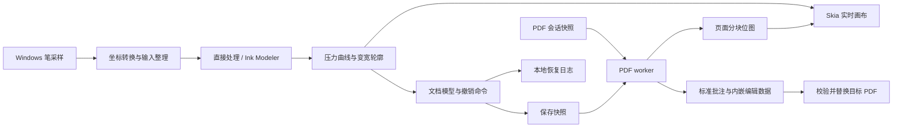

# Naive Note：Skia＋MuPDF 本地 PDF 手写笔记方案

## 一、目标与技术路线

在当前 `naive-note` 仓库中构建独立的 Windows 桌面应用，先完成：

**打开 PDF → 压感书写 → 撤销重做 → 保存标准批注 → 其他阅读器显示 → 本应用重开继续书写。**

已确定的产品行为：

- **本地运行**：文档、设置、恢复数据保存在本机，应用运行无需服务器或账号。
- **PDF 是主文件**：分享文档时携带一个 PDF 即可。
- **平滑默认开启**：使用 `ink-stroke-modeler-rs`，通过运行时开关关闭；不设置编译 feature gate。
- **手动保存**：Ctrl+S 更新 PDF，后台维护崩溃恢复日志。
- **首版先闭合书写链路**：暂缓荧光笔、橡皮擦、套索、文字图片编辑、图层和无限画布。

建议固定以下依赖基线，并提交 `Cargo.lock`：

| 职责                 | 首版方案                                 |
| -------------------- | ---------------------------------------- |
| Windows 构建         | Rust MSVC，`x86_64-pc-windows-msvc`      |
| 窗口与事件循环       | `winit 0.30.13`                          |
| OpenGL 上下文        | `glutin 0.32.3`＋`glutin-winit 0.5.0`    |
| 工具栏、设置、对话框 | `egui / egui-winit / egui_glow 0.37.0`   |
| 实时画布             | `skia-safe 0.157.0`，Ganesh OpenGL 后端  |
| 原生笔输入           | crates.io `tablet-input-windows` 1.0.0    |
| 可选笔迹建模         | `ink-stroke-modeler-rs 0.1.0`            |
| PDF 渲染和批注保存   | `mupdf 0.8.0`＋内置 MuPDF 1.27.2；模拟笔迹测试导出已接入，正式保存待实现 |

这些版本来自当前发布文档；egui 与 Skia 均有 glutin 接入示例，可作为集成起点。**共用上下文的代码已接入并通过编译，用户已确认空白窗口和 egui 文字显示正常；完整交互与绘制兼容性仍需继续验收。** [egui_glow](https://docs.rs/crate/egui_glow/0.37.0)、[skia-safe](https://docs.rs/crate/skia-safe/0.157.0)、[Skia OpenGL 示例](https://github.com/rust-skia/rust-skia/blob/master/skia-safe/examples/gl-window/main.rs)

Skia 首版关闭默认 features，开启 `binary-cache`、`gl` 和 `pdf`。0.157.0 的 Windows 预编译产物没有独立的 `ganesh-gl` 组合，需启用 `pdf` 匹配上游已发布的 `ganesh-gl-jpegd-jpege-pdf` 包；这不改变 MuPDF 负责已有 PDF 读取和批注保存的分工。画布文字加入时再启用 `textlayout`，避免第一阶段同时处理文字排版和 ICU。这里使用完整 Skia 引擎，按需选择编译模块。[官方预编译产物](https://github.com/rust-skia/skia-binaries/releases/tag/0.157.0)

首版界面采用单窗口、单文档：顶部工具栏，中央连续纵向页面，底部页码与缩放状态。支持打开、保存、另存为、撤销重做、颜色、笔宽、平滑开关，以及滚动、拖动平移和鼠标位置缩放。

## 二、模块边界与数据模型

先保持一个应用 crate，以普通模块组织职责：

| 模块       | 负责内容                                 |
| ---------- | ---------------------------------------- |
| `app`      | UI、快捷键、文档生命周期、未保存状态     |
| `platform` | Windows 窗口消息、原生笔输入、文件对话框 |
| `document` | 页面坐标、笔迹对象、编辑命令、撤销重做   |
| `ink`      | 输入整理、可选建模、压力曲线、变宽轮廓   |
| `render`   | Skia 绘制、OpenGL 资源、页面和笔迹缓存   |
| `pdf`      | MuPDF 调用、页面渲染、批注及附件读写    |
| `storage`  | 保存事务、恢复日志、设置                 |

使用 crates.io 的 `tablet-input-windows = "=1.0.0"`，由 Cargo.lock 锁定发布包校验和；不使用本地 path 或 vendor 依赖。MIT 许可证副本见 `licenses/tablet-input-windows-MIT.txt`。Rnote 用作功能和交互参考。



**线程分工**

- 主线程持有窗口、Windows Ink、笔迹处理器、OpenGL、Skia 和 egui。
- 一个 PDF worker 持有全部 MuPDF 对象，处理渲染与保存。
- 一个 I/O worker 处理恢复日志和设置写入。
- 跨线程只传拥有所有权的数据，PDF 句柄和 GPU 资源留在所属线程。

当前以单个 worker 串行持有 MuPDF 文档和页面，便于明确会话生命周期；不把引擎对象传到 UI 或 GL 线程。MuPDF 支持有约束的多线程使用，后续并行化需另行设计 context、锁及文档访问规则。[MuPDF 线程说明](https://mupdf.readthedocs.io/en/latest/using-mupdf-c.html#multi-threading)

**核心类型**

| 类型                 | 必须保存的信息                                      |
| -------------------- | --------------------------------------------------- |
| `RawSample`          | 页面位置、原始时间、可选压力、倾角、旋转及笔状态    |
| `ModeledSample`      | 建模后的位置、时间和压力                            |
| `PenStyle`           | 颜色、最大宽度、最小宽度比例、压力曲线              |
| `ProcessingSnapshot` | 算法名称、版本、参数及坐标单位                      |
| `StrokeRecord`       | 稳定 UUID、所属页面、原始点、建模点、最终轮廓、样式 |
| `DocumentRevision`   | 当前修订号、已保存修订号                            |
| `EditCommand`        | 首版实现 `AddStroke`，撤销删除对应新增笔迹          |

轮廓采用可序列化的路径命令，包含移动、直线、三次 Bézier 和闭合。文档模型不保存 `Skia Path` 或 GPU 缓冲；渲染端和 PDF 保存端消费同一份轮廓。

撤销历史在本次运行内有效，保存后仍可撤销本次新增笔迹；正常关闭再打开后建立新的历史。

## 三、输入、可选建模与实时绘制

**原生输入接入**

通过 winit 的 `with_msg_hook`，在读取下一条消息前同步提取笔历史，随后将采样送入应用队列。

- Down 时判断归属：工具栏输入交给 egui，画布输入归属对应页面。
- 归属通过 `stroke_id` 保持到 Up 或 Cancel，过滤同源笔生成的重复鼠标输入。
- 首版一条笔迹绑定一个页面，越界部分裁剪到该页。
- 书写期间固定视图变换，缩放和平移在抬笔后恢复。
- 失焦、设备中断或窗口关闭时结束活动笔迹：保留已确认部分，清除预测部分。
- 单点触碰生成圆点；缺失压力按固定压力处理，保留“缺失”信息。

统一处理客户区物理像素、UI 逻辑点、页面坐标之间的变换，涵盖 DPI、CropBox、页面旋转和 UserUnit。内部笔迹几何使用归一化纸面 point，保存时转换回 PDF 用户空间。

**`ink-stroke-modeler-rs` 的运行时开关**

`ink-stroke-modeler-rs = "=0.1.0"` 是普通依赖，Cargo.lock 锁定发布包。按 2026-11-09 用户要求，仅提供运行时开关，不设置编译 feature gate。

运行时提供两种模式：

- `InkModeler`：默认模式。
- `Direct`：关闭建模，直接使用整理后的真实采样生成轮廓。

工具栏 `Smoothing` 默认开启，关闭后新笔画使用 `Direct`；切换只影响下一笔，已有记录与活动笔画保持各自开始时的模式。该设置当前仅在本次运行内有效，持久化留待步骤 9。

建模库放在适配器后，`LiveStroke::new / push / finish` 管理每笔生命周期，取消直接丢弃活动对象；确认点和预测尾段分开返回。上游当前输入为位置、时间、压力，没有倾角和旋转字段；这些属性保存在原始采样中。[输入定义](https://github.com/flxzt/ink-stroke-modeler-rs/blob/main/src/input.rs)

具体处理约定：

- 使用采样时间戳，转换为相对本笔 Down 的秒数。
- 原始采样完整保留；相同时间戳的 Move 不重复送入建模器，适配器保留最新原始端点用于收尾。同时间戳 Up 在适配器中推进 1 微秒，保证点按也能完成；原始时间不变。时间倒退触发整笔 Direct 回退。
- 参数先以 `ModelerParams::suggested()` 为基线，输出频率取 180 Hz，单次输出上限取 200；记录为应用预设版本 1。
- 切换模式和参数只影响下一笔。
- `predict()` 输出只绘制到临时层；Up 时清除临时尾段，以最终确认结果完成笔迹。
- 建模失败时，以本笔原始采样完整重建为 `Direct`，并记录实际使用的算法，避免缺段。

上游包含 `update()` 和 `predict()`，但属于部分重实现，参数需要通过实笔负载调整。以后调参建立新的预设版本，历史笔迹继续使用已保存的轮廓。[项目说明](https://github.com/flxzt/ink-stroke-modeler-rs)、[建模接口](https://github.com/flxzt/ink-stroke-modeler-rs/blob/main/src/engine.rs)

**压力与轮廓**

首版实现不透明、圆头圆角的压感笔。默认最大宽度 2 pt、最小宽度比例 20%、压力指数 1.5：

```text
width = min_width + (max_width - min_width) × pressure^gamma
```

压力曲线在建模后统一应用一次。处理重复点、零长度段和急转弯，生成稳定的变宽填充轮廓。倾角和旋转暂不改变笔尖。

**Skia 与 UI 合成**

共用一个 OpenGL 上下文，按顺序执行：

1. 计算 UI 布局和画布区域。
2. Skia 绘制页面底图、已完成笔迹、活动笔迹和临时尾段。
3. flush Skia，并处理两个渲染器之间的 GL 状态切换。
4. egui 绘制工具栏、面板和弹窗。
5. swap buffers。

绘制顺序、裁剪、颜色空间、预乘 alpha 和资源释放顺序均由 `render` 模块统一管理。

PDF 页面按 512×512 像素分块，边缘增加 2 像素重叠；缩放时先显示已有块，再补高清块。初始 CPU、GPU 缓存预算各 128 MiB，采用 LRU，并计入 Skia 内部缓存。

活动笔迹增量生成稳定前段，只重建可变尾段；已完成笔迹缓存路径和可见区域图层。每帧纹理上传设预算，避免大批页面结果阻塞书写。

## 四、PDF 批注、保存与恢复

**一条笔迹在 PDF 中保存三层内容**

| 层次         | 内容                                              | 用途                         |
| ------------ | ------------------------------------------------- | ---------------------------- |
| 标准语义     | `/Ink`、`/InkList`、`/Rect`、稳定 `/NM`、打印标志 | 供阅读器识别为笔迹批注       |
| 标准外观     | `/AP /N` 中的变宽填充路径                         | 显示压感粗细                 |
| 应用编辑数据 | PDF 内嵌的版本化数据附件                          | 保留原始采样、参数和最终几何 |

步骤 3 已通过 MuPDF 的 PDF 批注接口写入 Ink 中心线和基础属性，并用安全对象及流接口安装自定义外观。保存、回读、再次更新和重新序列化的结构测试确认外观未被引擎自动生成的外观覆盖；实际跨阅读器显示仍按人工验收表记录。[MuPDF Rust 批注接口](https://docs.rs/mupdf/0.8.0/mupdf/pdf/struct.PdfAnnotation.html)

步骤 3 的应用数据已采用 `CBOR＋Zstd`，作为带文档 UUID 的版本 1 命名附件保存在 PDF 内，包含笔迹 UUID、页面关联、算法信息、原始点、处理后点、轮廓和批注 SHA256 指纹。回读会核对附件、中心线和外观一致性；失配时保留标准 PDF 并忽略编辑记录。正式保存事务仍在步骤 8 实现。[MuPDF Rust PDF 接口](https://docs.rs/mupdf/0.8.0/mupdf/pdf/struct.PdfDocument.html)

重开时以标准 PDF 外观显示已有笔迹。若附件缺失、版本不支持，或标准批注与记录指纹不一致，保留实际 PDF 内容并忽略失配的编辑记录；仍允许添加新笔迹。

其他阅读器可能在编辑时重建外观或清除应用数据，因此互通验收分别检查“显示正常”和“本应用数据仍完整”。

**会话显示策略**

打开时创建不可变的 PDF 会话快照：

- 原有页面及批注由 MuPDF 渲染为底图。
- 本次运行新增的笔迹全部由 Skia 叠加。
- 保存成功后，继续沿用该底图和叠加层。
- 每次保存从初始快照生成副本，加入当前仍存在的会话笔迹。

这样可以直接撤销本次已经保存过的笔迹，也能避免底图与叠加层重复绘制。正常关闭再打开时，已保存笔迹成为新会话的底图内容。

**保存事务**

首版使用完整副本保存：

1. 活动笔迹结束后，取得修订号为 R 的不可变保存快照。
2. PDF worker 从会话基础 PDF 创建保存文档。
3. 写入当前新增批注，更新应用数据附件。
4. 输出到目标 PDF 同目录的唯一暂存文件。
5. flush 并回读，核对页数、页面尺寸、新批注 ID、InkList、外观和应用数据。
6. 检查目标文件是否被外部修改。
7. 释放目标相关句柄，通过 Windows 文件替换操作提交。
8. 将 R 标记为已保存；保存过程中产生的新修订继续保持未保存状态。

保存失败时保留文档脏状态和恢复数据。目标被其他程序占用、只读、磁盘不足或发生外部修改时，给出具体原因及重试、另存为入口。

首版可编辑范围限定为普通、未加密、未签名且允许批注的 PDF。已有链接、书签、批注和表单内容纳入保留测试；加密、签名文档先作为只读范围处理。

**崩溃恢复**

本机应用数据目录保存会话基础 PDF 快照和带校验的追加日志：

- 每笔结束及撤销重做后，将命令交给 I/O worker 落盘。
- 日志包含基础文件指纹、最新目标文件指纹和保存修订号。
- Ctrl+S 成功后记录保存检查点；基础快照保留到会话正常结束。
- 异常退出后，恢复到最后完整、已同步的记录；损坏的日志尾部舍弃。
- 目标 PDF 已被外部修改时，恢复结果通过另存为输出。

恢复保证以已确认落盘的记录为界；活动笔迹不作为完整恢复单位。开发测试生成的数据统一放在项目内 `.scratch`。

## 五、实施阶段与验收

| 阶段               | 交付内容                                                 | 通过条件                                                     |
| ------------------ | -------------------------------------------------------- | ------------------------------------------------------------ |
| P0：构建与关键接口 | MSVC、egui＋Skia 共用 GL、MuPDF 链接、单条压感批注及附件 | 干净构建、启动显示、保存重开；Edge 与 Acrobat 能看到变宽外观 |
| P1：实时书写       | 原生笔接入、默认建模、关闭建模、压力轮廓、缩放平移       | 点按、慢写、快写、转折、抬笔及取消正确，无重复输入           |
| P2：编辑闭环       | 文档修订、撤销重做、正式批注保存、另存为                 | 保存后继续写及撤销，再保存重开，内容和数量准确               |
| P3：可靠性与交付   | 恢复日志、缓存预算、错误处理、便携包、文档               | 故障注入及实机验收通过，记录性能和兼容性结果                 |

**自动验证**

- 坐标正逆变换：旋转、CropBox、UserUnit、缩放和 DPI。
- 输入生命周期：重复点、相同时间、缺失压力、取消、长时间间隔。
- 两种处理模式、建模失败降级、预测点不进入保存数据。
- 单点、急转、长笔迹的轮廓有效性与序列化。
- 保存期间继续编辑、保存后撤销、重复保存无重复批注。
- 失败写入、截断日志、损坏附件和外部修改冲突。
- 同一构建中验证运行时平滑开启与关闭，以及旧处理快照的兼容读取。

**人工验收**

- 真实压感笔下测试 100%、150%、200% DPI及跨屏。
- 测试中文 PDF、扫描页、旋转页、复杂向量页和已有批注。
- 在 Edge、Acrobat 中检查显示和打印，再回本应用检查数据。
- 分别测试保存各阶段终止进程，确认目标文件和恢复结果。
- 在未安装 GTK、MSYS2、MinGW 的 Windows 环境运行发行包。

**性能证据**

固定同一台机器和可重放输入，测试持续增长的长笔迹、万条已完成笔迹、大 PDF 快速滚动，以及 PDF 与墨迹同时显示。

首轮目标设为：

- 常规负载下，60 Hz 显示的应用帧耗时 P95 不超过 16.7 ms。
- 单独记录采样处理、轮廓生成、CPU 绘制、GPU 耗时、纹理上传量和峰值缓存。
- 软件事件到提交延迟与高速摄影测得的笔尖到显示延迟分开报告。

这些是待验证目标。当前已实现 winit/glutin 窗口与共享 GL 的 Skia/egui 骨架、MuPDF 连续多页阅读及模拟压感笔迹/附件保存回读。用户已确认早期空白窗口与 egui 文字显示正常，在 2026-11-06 反馈保存样本查看无问题，并在 2026-11-07 确认多页阅读总体视觉无问题。上述反馈未细分专项；DPI、性能、具体交互、跨阅读器和打印的逐项结果仍需记录。原生笔与 Direct 书写已于 2026-11-09 接入；用户同日确认当前书写效果总体无问题，DPI、跨屏和性能专项仍待记录，正式保存尚未实现，P0 尚未宣告全部通过。

MuPDF 由锁定的 `mupdf-sys 0.8.0` 源码编译并链接，不单独分发 MuPDF DLL；原生依赖与 Skia 预编译包使用一致的 release CRT。发行包仍需补齐完整的依赖声明、许可证和源码提供安排。Skia 优先使用匹配的 MSVC 预编译缓存。首轮依赖准备后验证离线构建，运行验收在断网条件下覆盖。[Skia 构建供应](https://github.com/rust-skia/rust-skia#platform-support-build-targets-and-prebuilt-binaries)、[MuPDF Rust 绑定](https://github.com/messense/mupdf-rs)、[依赖声明](THIRD_PARTY_NOTICES.md)

第一版闭环通过后，再按“对象橡皮擦与套索 → 荧光笔和文本高亮 → 图片、文字与页面工具”的顺序扩展，继续沿用同一份笔迹模型、Skia 画布和 PDF 保存边界。

## 六、渐进实现步骤

以下将 P0—P3 拆成可以逐步运行、验证和提交的小步骤。每一步完成后更新本节状态，记录实际执行的检查与尚未通过的验收；编译通过、功能实现和用户实机验收分别记录。继续保持一个应用 crate，模块随功能增加，不提前堆放空接口。

### 步骤总览

| 状态 | 步骤 | 可交付结果 | 对应阶段 |
| --- | --- | --- | --- |
| 已完成 | 0. 窗口与共享 GL 骨架 | 空白窗口、Skia 背景、egui 文字 | P0 的一部分 |
| 已完成 | 1. 画布区域与坐标基础 | 能缩放、平移和裁剪的测试纸面及坐标数学测试 | P0 / P1 基础 |
| 已完成 | 2. MuPDF 加载与单页显示 | 后台打开真实 PDF 并将第一页预览交给 Skia | P0 |
| 已实现 | 3. PDF 保存关键接口验证 | 一条模拟压感笔迹和附件已可保存、回读；用户反馈当前查看无问题 | P0 关键关卡 |
| 已实现 | 4. 多页阅读与视图交互 | 连续纵向页面、页码、滚动定位、适合页宽及跨页缓存；用户已确认总体视觉 | P1 基础 |
| 已实现 | 5. 原生笔与 Direct 书写 | 原生采样、压感叠加、固定压力鼠标调试及取消处理 | P1 |
| 已实现| 6. 可选笔迹建模 | 默认平滑、运行时关闭、预测尾段隔离与整笔 Direct 回退 | P1 |
| 待实现 | 7. 编辑命令与文档状态 | 撤销重做、修订号、未保存提示 | P2 |
| 待实现 | 8. 正式保存与重开闭环 | Ctrl+S、另存为、事务保存、重开继续写 | P2 |
| 待实现 | 9. 恢复日志与设置 | 异常退出可恢复、设置可持久化 | P3 |
| 待实现 | 10. 分块缓存与性能优化 | 大 PDF 和长笔迹受预算约束地运行 | P3 |
| 待实现 | 11. 兼容性验收与便携交付 | 可分发的 Windows 包及完整验收记录 | P3 |

### 0. 窗口与共享 GL 骨架

**当前已实现**

- `app` 管理窗口生命周期、事件路由、按需重绘和 F12 信息条。
- `platform` 持有 winit 窗口、glutin OpenGL 3.3 上下文与窗口 surface。
- `render` 接入 Skia Ganesh 和 egui，依次绘制背景、flush、绘制 UI、交换缓冲，并管理资源释放顺序。
- Skia 使用 `binary-cache + gl + pdf` 匹配上游 Windows 预编译包；egui 显式启用 `default_fonts`。
- 初始化后同步提交首帧，再显示窗口，避免隐藏窗口等待重绘事件。

**已有证据**：MSVC 构建、静态检查通过；用户已确认空白窗口与 egui 文字显示正常。

**待补验收**：调整窗口大小、最小化后恢复、正常关闭，以及 100%、150%、200% DPI 和跨屏变化。基础显示通过不代表这些场景全部通过，也不代表 P0 已完成。

### 1. 画布区域与坐标基础

**实现内容**

- 在 `app` 中确定工具栏、状态栏和中央画布的布局边界，将中央区域以明确的逻辑坐标和物理像素尺寸交给 `render`。
- 在 `document` 中定义最小页面几何与视图变换；统一客户区物理像素、egui 逻辑点、归一化纸面 point 和 PDF 用户空间之间的转换，覆盖 CropBox、旋转和 UserUnit。
- 先用程序生成的测试纸面绘制页边界和定位标记，接入滚动、拖动平移、鼠标位置缩放与页面裁剪。正式 PDF 数据随后替换测试数据。
- 让 egui 区域参与输入归属判断，避免工具栏上的鼠标操作同时移动画布。

**主要模块**：`app`、`document`、`render`。

**通过条件**：缩放后鼠标对应的纸面位置保持稳定；定位标记正逆变换一致；画面不越过画布边界；DPI 和窗口尺寸变化后位置正确。为坐标变换添加覆盖旋转、偏移和 UserUnit 的测试。

**当前已实现**

- `app::canvas` 划分工具栏、固定高度状态栏和透明中央画布，通过 egui response 确定输入归属。支持滚轮、Shift＋滚轮、左键或中键拖动、Ctrl＋滚轮鼠标锚点缩放、适合页面、100% 和四向旋转；缩放范围 10%—800%。
- `document` 使用 f64 定义 CropBox、旋转、UserUnit、归一化纸面和视图变换，100% 时按 96/72 逻辑像素 / 纸面 point 换算，DPI 单独应用。适合页面随布局更新；手动模式保持画布中心锚点。
- `render` 接收中央区的逻辑 / 物理矩形、DPI、页面几何和视图；Skia 绘制网格、四色角标和测试圆形，并分别裁剪到中央画布与纸张边界。
- 坐标数学测试覆盖偏移、旋转、非整数 UserUnit、缩放锚点及范围、布局变化、DPI、非法输入和正逆映射；不创建窗口。

**非窗口验证（2026-11-06）**：`cargo fmt --all -- --check`、Clippy 全目标零警告检查和 MSVC 离线锁定构建通过；`cargo test --offline --locked document::` 的 10 个坐标数学测试通过。

**验收状态**：实现已接入；窗口、视觉和实际输入验收由用户按 [画布手动验收](docs/canvas-validation.zh-CN.md) 执行，尚未通过验收。未打开 PDF 时继续显示程序生成的测试纸面。

### 2. MuPDF 加载与单页显示

**实现内容**

- 引入固定版本 `mupdf 0.8.0`，由 `mupdf-sys 0.8.0` 编译内置 MuPDF 1.27.2；锁文件记录包校验值，另附依赖和许可证说明。
- 在 `pdf` 中启动单个 worker，由它独占全部 MuPDF 对象；主线程通过命令和结果消息交互，消息只携带拥有所有权的数据。
- 增加打开入口和文件对话框，打开时建立不可变会话快照，读取真实页面尺寸、CropBox、旋转和 UserUnit。
- 先渲染第一页的有界尺寸位图，明确像素顺序和 alpha 约定，上传到 Skia 并显示在步骤 1 的页面区域内。
- 打开失败、密码保护、空文档和超过预览大小限制时显示错误；中文 PDF 使用 MuPDF 与系统字体回退渲染。

**主要模块**：`platform`、`pdf`、`document`、`render`、`app`。

**通过条件**：普通 PDF 第一页可显示；扫描页、中文内容、旋转页分别检查；加载过程不阻塞主线程；关闭文档后不残留任务和句柄。此时只确认阅读能力，尚不能宣称支持书写和保存。

**当前已接入（2026-11-06）**：原生文件对话框、Ctrl+O、文件拖入和启动路径参数；单个 MuPDF worker 建立内存快照与第一页显示列表，返回页数、实际 CropBox/旋转/UserUnit 和有界 RGBA8 底图；接入原有缩放、平移、适合页面和额外视图旋转；Ctrl+W 关闭并返回测试页。单文件预览上限 256 MiB，整页底图最长边 2048 px；按缩放与屏幕 DPI 为可见区域补渲 512×512 px 分块，重叠 2 px，需求变化防抖 120 ms，CPU 像素 LRU 与 Skia GPU 资源缓存分别设为 128 MiB。最多同时需要 96 块，超大可视区降档；文档快照、显示列表和临时缓冲另计。Skia 共享 CPU 像素，按当前可见块保留图像。文档编号与渲染请求编号过滤旧结果，打开失败保留当前页面和会话。分块之间取消旧任务；单次 MuPDF 调用无法中途抢占，退出时等待 worker 收尾。高清清晰度、接缝、交互与跨 DPI 效果仍待用户按验收文档手动检查。

**验收状态**：无窗口检查与用户手动项目见 [MuPDF 验收](docs/mupdf-validation.zh-CN.md)；实际窗口、视觉、中文字体回退及文件对话框行为仍待用户验收。

### 3. PDF 保存关键接口验证

这一步先验证 PDF 写入路线，再投入完整的原生笔和编辑界面。模拟压力数据用于验证外观与保存接口，不能替代真实笔验收。

**实现内容**

- 定义最小 `PenStyle`、`StrokeRecord`、`ProcessingSnapshot` 和可序列化轮廓，构造一条带模拟压力变化和稳定 UUID 的笔迹；屏幕与 PDF 消费同一份最终轮廓。
- 在会话基础 PDF 的副本上创建标准 `/Ink` 批注，写入 InkList、Rect、NM、打印标志，并写入表示变宽填充路径的 `/AP /N` 外观。
- 将带格式版本和文档 UUID 的编辑记录编码为 CBOR＋Zstd 附件，保存到项目 `.scratch` 下的测试输出。
- 回读输出，核对批注 ID、数量、InkList、外观和附件内容，并在本应用重新显示结果。
- 在 Edge 和 Acrobat 中人工检查粗细变化与打印外观；若接口组合不能实现目标，先解决或修订保存路线，再推进正式书写功能。

**主要模块**：`document`、`ink`、`pdf`、`render`。

**通过条件**：保存和回读结果一致；外部阅读器能显示变宽笔迹；附件能解码并关联对应批注。记录测试样本和阅读器结果。结合步骤 0、2 的构建与启动证据后再核对 P0 是否满足，不能以“保存 API 返回成功”作为 P0 通过依据。

**当前已实现（2026-11-06）**：最小笔迹数据类型和 Direct 模拟样本（97 个原始/处理后采样），稳定笔迹 UUID、样式和处理快照、可序列化轮廓；Skia 和 PDF 使用同一份变宽填充轮廓。MuPDF worker 从不可变源字节创建副本，写入 `/Ink`、`InkList`、`Rect`、`NM`、打印标志及自定义 `/AP /N`，嵌入带文档 UUID 和指纹的版本 1 CBOR＋Zstd 附件。测试导出写到项目 `.scratch/pdf-save-probe/<UUID>/pressure.pdf`，同步后回读。工具栏 `Pressure demo`、`Export test PDF` 用于预览、导出和自动重新打开；CLI `--pdf-save-probe [源文件]`、`--pdf-inspect 文件` 提供无窗口样本生成和结构核验。

**验证与验收**：无窗口测试覆盖所有页面旋转、偏移 CropBox、UserUnit、原有内容和附件名称树保留、重复导出、重开再更新时 AP 保留、附件损坏和外部修改失配、加密/签名拒绝，以及 worker 生命周期。2026-11-06 用户反馈“我看过了 没问题”；Edge、Acrobat、打印和外部保存附件保留的具体结果仍待按 [PDF 保存验收](docs/pdf-save-validation.zh-CN.md) 逐项记录。此阶段不包含原生笔、Ctrl+S、原子替换及未保存提示。

### 4. 多页阅读与视图交互

**实现内容**

- 将单页显示扩展为连续纵向页面，接入当前页码、总页数、滚动定位与缩放状态。
- 使用真实页面几何，按可见区域调度渲染；第一版可缓存有限数量的整页低分辨率结果，先限制位图尺寸与总内存，步骤 10 再替换为正式分块缓存。
- 每个结果携带文档会话和请求标识；切换文档或改变缩放后丢弃过期结果，避免旧文档内容覆盖当前页面。
- 页面现有内容和批注来自 MuPDF 底图，为后续新增笔迹保留独立叠加层。

**实现记录（2026-11-07）**：MuPDF worker 返回全部页面几何，中央画布按真实尺寸居中纵向排列，仅请求可见页。新增上一页/下一页、页码输入、PageUp/PageDown、Home/End 和 Fit width；指针按所在页换算坐标，额外视图旋转应用于整篇文档。底图最长边调整为 1024 px、最高 72 DPI，使用共享 64 MiB LRU；原有 128 MiB 分块缓存加入页号，所有可见页共用最多 96 个高清块，80 ms 防抖，单 worker 逐项返回结果并过滤过时请求，最多缓存 4 页引擎显示列表。模拟压感叠加与测试导出继续限定第一页。

无窗口测试覆盖布局与可见页、页间命中、导航与缩放锚点、逐页后台结果、混合页面几何、显示列表数量、跨页分块与底图缓存、过时请求过滤和关闭取消；52 项测试、格式检查、Clippy 和同一源码的临时命名构建通过。2026-11-07 用户反馈“视觉确认没问题”，总体视觉已确认；快速滚动流畅度、DPI、性能和具体交互的专项结果仍按 [多页阅读手动验收](docs/multipage-validation.zh-CN.md) 补齐记录。

**主要模块**：`app`、`document`、`pdf`、`render`。

**通过条件**：不同尺寸和旋转的页面位置正确；快速滚动与缩放不串页；工具栏操作不移动纸面；加载时 UI 仍可响应；已加载页面在补充清晰结果前保持可见。

### 5. 原生笔与 Direct 书写

**实现内容**

- 使用 crates.io 发布的 `tablet-input-windows = "=1.0.0"`，通过 winit `with_msg_hook` 同步提取原生笔及历史采样；许可证单独保留。
- 实现 Down、Move、Up、Cancel 生命周期、输入归属和同源鼠标过滤；一次笔迹绑定一个页面，书写时固定该笔使用的视图变换。
- 保留原始时间、缺失压力、倾角和旋转信息；先实现 `Direct` 路径，不经过建模库。
- 按约定压力曲线生成圆头、圆角的变宽填充轮廓，处理单点、重复点、零长度段和急转弯，并裁剪到所属页面。
- 已完成笔迹成为文档记录；活动笔迹单独绘制。提供固定压力的鼠标输入路径，便于无笔设备调试。

**主要模块**：`platform`、`ink`、`document`、`render`、`app`。

**通过条件**：真实压感笔能在 PDF 页面上点按、慢写和快写，且无重复鼠标笔迹；工具栏不落笔；越界、失焦、取消和抬笔处理正确。鼠标测试通过不能替代实笔与 DPI 验收。此步的 Direct 是中间交付，最终默认平滑在下一步完成。

**实现记录（2026-11-09）**：已接通 crates.io 原生库、历史采样、笔源鼠标过滤和 UI 笔操作；Down 固定页面、原始页面方向、视图与 DPI，保留时间、缺失压力及独立倾角轴等设备属性。Direct 使用 2 pt / 20% / gamma 1.5 的圆头填充轮廓，按增量追加几何；已完成记录与活动层分开，纸面及视口共同裁剪，底图未到达时仍能显示墨迹。失焦、取消、捕获丢失、窗口尺寸或 DPI 变化丢弃活动笔迹。鼠标默认继续平移，开启 Mouse pen 后左键以 0.5 压力书写。会话笔迹带未保存计数；正式保存、撤销重做和恢复仍属后续步骤。存在会话笔迹时禁用仅导出模拟笔迹的测试按钮。无窗口测试、格式检查及严格 Clippy 通过；用户同日反馈“没问题了 我测过了”，总体书写效果已确认；设备、DPI、跨屏和性能的逐项结果仍按 [笔输入手动验收](docs/ink-validation.zh-CN.md) 记录。

步骤 5 补充（2026-11-09）：按用户指定接入 Ctrl＋笔拖动缩放、Alt＋笔拖动平移，鼠标左键遵循相同规则；Ctrl 优先。缩放基于逻辑像素，以操作开始位置为锚点。原生笔事件同步记录键盘状态并传给 UI；中途切换修饰键先在最后一个书写采样点终结并提交当前笔画，保留已有笔迹，再响应导航；导航点不接入笔画，后续抬笔不重复提交，松键后需抬笔重新开始书写。本次修饰键行为的视觉、实笔与窗口结果仍待用户单独验收。

### 6. 可选笔迹建模

**实现内容**

- 在 `ink` 中用 `LiveStroke` 管理创建、输入与终结，取消直接丢弃；通过适配器封装普通依赖 `ink-stroke-modeler-rs = "=0.1.0"`，不设置编译 feature gate。
- 按前文约定处理相对时间、重复时间戳、输出频率和输出上限，记录算法及预设版本。
- 区分确认点和预测尾段；预测仅用于当前帧临时显示，抬笔后清除，不进入文档记录或保存数据。
- 提供默认开启的运行时 `Smoothing` 开关，关闭后使用 Direct。参数或模式变化从下一笔生效。
- 建模失败时根据本笔完整原始采样重建 Direct 轮廓，并在记录中保存实际使用的处理方式。

**主要模块**：`ink`、`document`、`app`、`render`。

**通过条件**：同一构建中可切换两种模式并读取已有记录；两种模式的点按、慢写、快写、急转和取消正确；故障测试中降级不缺段，预测点不会进入保存快照。结合步骤 4、5 完成 P1 验收。

**实现记录（2026-11-09）**：已接入锁定版本的建模库及工具栏 `Smoothing`，原生笔和 Mouse pen 共用运行时选择的处理路径。每笔以相对 Down 的秒数输入，使用 suggested 基线、180 Hz 和单次 200 点上限，保存全部实际参数及预设版本 1。确认轮廓增量追加，预测轮廓单独留在不可序列化的 `ActiveInk`，Up、取消和工具切换后清除。Ctrl/Alt 中途导航及鼠标无位置释放在最后一个书写采样点完成建模，不添加伪造的原始采样。长采样间隔、时间倒退或无效输出触发整笔 Direct 重建，并记录实际算法。旧版本 1 快照缺少建模参数时仍可读取。88 项无窗口测试、格式检查、严格 Clippy 及离线构建通过。2026-11-09 用户反馈“我测了 没问题”，建模后的书写效果总体已确认；DPI、跨屏、延迟和性能专项仍按 [笔迹建模验收](docs/modeling-validation.zh-CN.md) 补齐记录。

### 7. 编辑命令与文档状态

**实现内容**

- 用 `AddStroke` 命令统一提交笔迹，并维护撤销栈、重做栈、当前修订号和已保存修订号。
- 接入撤销重做快捷键和按钮；撤销后新增笔迹清除重做分支，已保存的本次会话笔迹仍可撤销。
- 接入颜色、笔宽和平滑设置；活动笔迹使用开始时的样式与处理快照，设置变化只影响下一笔。
- 在标题或状态栏显示未保存状态；切换、打开或关闭文档时处理活动笔迹和未保存确认，保存分支在步骤 8 接通。

**主要模块**：`document`、`app`、`ink`、`render`。

**通过条件**：新增、撤销、重做和分支编辑后的笔迹数量及修订状态正确；撤销能回到已保存状态；页面底图和会话叠加层不重复显示。此时以会话内编辑验收为主，P2 仍待正式保存闭环。

### 8. 正式保存与重开闭环

**实现内容**

- 将步骤 3 的关键接口验证接入 Ctrl+S、另存为和未保存提示，活动笔迹结束后取得修订号为 R 的不可变保存快照。
- PDF worker 每次从初始会话快照生成副本，仅加入当前仍存在的会话笔迹，沿用前文的底图与叠加层策略。
- 实现同目录唯一暂存文件、flush、回读校验、外部修改检查、释放句柄与 Windows 文件替换；成功后仅将 R 标为已保存。
- 保存期间允许继续编辑，新修订保持未保存；保存失败保留脏状态，并提供重试或另存为。
- 重开时恢复新的会话底图并读取编辑附件；缺失、损坏、不支持版本或指纹失配时保留标准 PDF 内容，忽略失配记录，仍允许新增笔迹。

**主要模块**：`app`、`document`、`pdf`、`storage`。

**通过条件**：完整走通“打开 → 写字 → 保存 → 继续写 → 撤销已保存的会话笔迹 → 再保存 → 重开”；重复保存无重复批注，保存期间新增编辑不被误标为已保存；只读、占用、写入失败和外部修改不会损坏原文件。完成 P2，并再次人工核对 Edge、Acrobat 与本应用的显示。

### 9. 恢复日志与设置

**实现内容**

- 在 `storage` 中增加 I/O worker，持有恢复文件和设置写入；文档与 GPU 对象仍留在各自所属线程。
- 保存会话基础快照、文件指纹、带校验的追加命令日志和保存检查点；每笔完成及撤销重做后排队落盘。
- 启动时检测未正常结束的会话，只恢复最后完整且已同步的记录，忽略损坏尾部；目标文件已变化时通过另存为恢复。
- 持久化颜色、笔宽、运行时平滑模式等设置，并处理设置格式版本。
- 开发与故障测试数据使用项目 `.scratch`；正式运行使用本机应用数据目录。

**主要模块**：`storage`、`document`、`app`、`pdf`。

**通过条件**：在日志写入和保存各阶段终止进程后，目标 PDF 保持完整；恢复结果符合已确认落盘的记录；损坏日志、设置和附件不会阻止启动。活动中的未完成笔迹不作为完整恢复单位。

### 10. 分块缓存与性能优化

**实现内容**

- 用 512×512 像素、边缘重叠 2 像素的页面分块替换早期整页缓存，按可见区域与请求优先级调度。
- 建立 CPU、GPU 各 128 MiB 的初始预算和 LRU，GPU 统计纳入 Skia 内部缓存；限制每帧纹理上传量。
- 缓存键包含文档会话、页面、缩放级别和所需修订信息，切换文档、过期请求或编辑变化时正确失效。
- 活动笔迹增量保留稳定前段，仅重建可变尾段；已完成笔迹缓存路径，减少每帧重复构造。
- 基于固定样本记录处理、几何生成、CPU 绘制、GPU、纹理上传、峰值内存和缓存命中情况，再据测量调整预算。

**已提前接入的子集（2026-11-06）**：步骤 2 的第一页只读预览已有可见区域分块、缩放/DPI 档位、旧任务取消、120 ms 防抖及有界 CPU LRU/Skia GPU 缓存。整页底图仍作即时回退。多页预取、修订失效、每帧上传预算和实机性能测量尚未完成，步骤 10 仍未整体完成。

**主要模块**：`pdf`、`render`、`ink`、`document`。

**通过条件**：大 PDF 快速滚动、连续缩放、长笔迹和万条已完成笔迹下，内存受预算约束；分块无可见接缝、串页或失效残影。用固定设备和负载检查前文 P95 目标，未达标时保留实测数值与问题记录。

### 11. 兼容性验收与便携交付

**实现内容**

- 按第五节人工验收清单覆盖压感笔、不同 DPI 与跨屏、中文与扫描 PDF、旋转和已有批注；检查原有链接、书签、表单等内容的保留。
- 在 Edge、Acrobat 中分别检查显示、打印，以及外部修改后返回本应用的附件或批注失配行为。
- 制作包含 EXE、许可证、依赖声明和所需源码提供说明的便携包；核对 MSVC 运行库，在未安装 GTK、MSYS2、MinGW 的 Windows 环境验证。
- 依赖准备后验证离线构建，并在断网条件下进行运行验收；区分已准备缓存的离线重建和首次联网准备依赖。
- 汇总自动检查、用户实机操作、故障注入和性能测量证据，更新 README 与本计划状态。

**主要模块**：构建与发行配置、文档，以及前面各模块的缺陷修复。

**通过条件**：第一节的核心书写链路、第五节验收和本节交付要求均有对应记录；未执行或未通过的项目明确列出。达到这些条件后再将 P3 和首版闭环标记为完成。

### 首版之后的顺序

首版闭环完成后，再依次安排对象橡皮擦与套索、荧光笔和文本高亮、图片与文字、页面工具，最后单独设计图层或无限画布。每项扩展先确认文档模型、标准 PDF 表达、撤销和恢复语义，再实现交互与渲染。

**当前状态：步骤 6“可选笔迹建模”已实现，默认开启并支持运行时关闭；2026-11-09 用户反馈“我测了 没问题”，建模后的书写效果总体已确认。下一实现步骤为步骤 7“编辑命令与文档状态”。** 步骤 5 的 Direct 书写已获用户总体确认；步骤 3 已实现保存接口与回读，用户反馈当前查看无问题。专项交互、性能、跨阅读器、打印及前序完整窗口/DPI 项目继续按验收表补齐记录。
