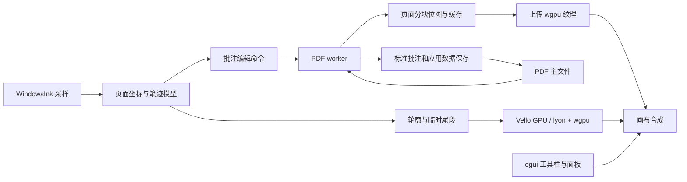

# Windows PDF-native 笔记软件：渲染与保存可行性评估

核对日期：2026-11-05。范围：Windows、Rust MSVC、egui；PDF 是主文件，保留原页面，手写与高亮保存为标准 PDF 批注。

历史评估说明（2026-11-06）：本文保留当时的候选比较；当前实现已使用 egui/OpenGL＋Skia，PDF 引擎按用户要求改为 MuPDF。以 [当前计划](../PLAN.md)、[README](../README.md) 和 [MuPDF 验收](mupdf-validation.zh-CN.md) 为准。

本文依据本地代码和上游文档、公开 API 进行评估。没有创建笔记应用，没有执行渲染基准、GPU 集成、真实笔书写或跨阅读器保存测试。下文的选型是工程建议，验收项目均仍待执行。

## 结论与推荐组合

可行。建议将系统分为三个独立部分：实时画布、PDF 引擎、PDF 批注存储；让它们共享页面坐标与笔迹几何，而不是要求一个库承担全部工作。

| 职责 | 优先验证的方案 | 判断 |
| --- | --- | --- |
| UI 与窗口 | egui；窗口可用 eframe 或自管 winit | 现有笔输入库已有 winit 接入例子，适合延续 |
| 实时墨迹、形状、图片画布 | `vello_gpu`，通过 wgpu 接入 egui | 更接近完整笔记画布的需求；须验证其图层、混合与设备兼容性 |
| 以书写为中心的精简画布备选 | `lyon` 三角化 + 自定义 wgpu 管线 | 控制直接、范围较小；抗锯齿和图层合成需要自己承担 |
| PDF 页面显示、文本定位与批注读写 | PDFium，Rust 侧优先考察 `pdfium-render` | 第一版最值得验证的 PDF 引擎组合；包含 C++ DLL，但不要求 GTK/MSYS2/MinGW |
| 完全 Rust 的 PDF 备选 | `hayro` 显示 + `lopdf` 修改/增量保存 | 技术上可组合，批注、原文档保真与两套文档状态的协调工作更多 |

完整功能方向优先做 **egui + wgpu + Vello GPU + PDFium** 的最小验证。若第一阶段只实现压感钢笔、套索和少量形状，`lyon + wgpu` 也可作为正式方案；不必同时长期维护两个实时画布后端。

这里将“尽量避免 GNU 依赖”理解为减少 Windows 下 MSYS2/MinGW 和 GNOME 原生依赖配置。允许使用能够被 Rust MSVC 应用调用的 C/C++ 库。实现语言、编译工具链、运行时依赖与许可证是四个不同问题。

## 1. 实时墨迹同样需要渲染器

本仓库提供的是采样，不是绘图引擎。`PenSample` 已有压力、倾角、旋转、时间、笔画编号；`examples/winit_ink.rs` 使用 `with_msg_hook` 同步读取原生消息。应用仍须完成：

```text
WindowsInk / PenSample
    → 客户区物理像素转换为 PDF 页面坐标
    → 压力响应、采样整理、平滑、笔尖模型
    → 变宽轮廓/路径与实时尾段
    → Vello GPU 或 lyon + wgpu
    → 与 PDF 页面纹理、选区及 egui UI 合成
```

这些步骤不全由渲染库提供。尤其是压感曲线、笔迹平滑、尾段预测和橡皮擦语义，属于笔工具/几何层。预测点只用于临时显示，保存时使用真实采样。

| 实时画布方案 | 能提供什么 | 应用仍需承担什么 |
| --- | --- | --- |
| `vello_gpu` | 2D 路径、图片、字形与合成；wgpu 后端 | 压感笔尖、输入算法、编辑模型；验证所需混合模式和图层能力 |
| `lyon + wgpu` | 将路径转换为 GPU 可绘制的三角网格；描边支持按顶点属性调节宽度 | GPU 管线、抗锯齿、裁剪与混合；完整文字与复杂画笔另行实现 |
| `skia-safe` | 成熟的 C++ 2D 绘图库，CPU/GPU 能力；有 Windows MSVC 预编译产物 | 笔工具算法；与 egui-wgpu 的 GPU 资源互操作、构建与包体管理 |
| `vello_cpu` / `tiny-skia` | CPU 路径光栅化，适合软件渲染、缩略图及对照测试 | 脏区管理与纹理上传；高 DPI 大画布的实时成本需测量 |
| egui Painter / Mesh | 足以构建早期墨迹原型，也能显示自行生成的网格 | 不能据此认为完整压感笔、复杂合成与大文档缓存已经解决 |

Lyon 的 `variable_line_width` 明确支持以自定义顶点属性调节线宽；但它输出网格，本身不负责屏幕光栅化和抗锯齿。[Lyon 官方说明](https://github.com/nical/lyon)、[StrokeOptions](https://docs.rs/lyon_tessellation/latest/lyon_tessellation/struct.StrokeOptions.html)

当前 Vello 项目区分 `vello_cpu`、`vello_gpu` 与实验性的 compute `vello`，不能将三者混为一谈。`vello_gpu` 已有 wgpu 后端，但文档仍列出 mask layers、复杂滤镜与部分非隔离混合模式的限制。因此推荐它作为优先验证对象，不将它描述为全部能力均已成熟。[Vello 官方说明](https://github.com/linebender/vello)、[Vello GPU 当前限制](https://github.com/linebender/vello/tree/main/vello_gpu)

若只支持基本钢笔，优先使用变宽描边；若需要倾斜笔尖、书法笔及与 PDF 外观一致的输出，建议笔工具生成独立于后端的填充轮廓。屏幕端与 PDF 保存端消费同一份轮廓，减少抬笔、保存及重开后的外观差异。不要仅保存 GPU 顶点缓冲。

荧光笔需要确定同一笔内部是否重复叠色、不同笔之间怎样混合，以及是否使用 Multiply。逐段绘制半透明圆点容易产生接缝与局部加深，不能只用普通 alpha 混合作为验收标准。

## 2. PDF 渲染后端比较

| 方案 | Windows 与依赖 | 对当前目标的适配 |
| --- | --- | --- |
| PDFium | C++ 引擎，通过 C API 调用；可以随应用分发 Windows DLL | 同时覆盖页面渲染、文本访问和多种批注操作，优先考察 |
| MuPDF | C 引擎，有 Windows 支持；不因使用它就必须使用 GNU 编译器 | 可承担渲染和编辑，但需单独决定 AGPL 或商业授权是否适合项目 |
| `hayro` | Rust PDF 解析、解释和光栅化；当前 `hayro` 使用 `vello_cpu` | 值得认真验证的显示方案；不是现成的完整 PDF 批注编辑器 |
| `Windows.Data.Pdf` | 系统 WinRT API，无需随应用携带另一个 PDF 引擎 DLL | 公开接口侧重文档加载和页面输出；仅靠它不足以完成文本定位及标准批注编辑闭环 |
| Skia / Vello / tiny-skia | 通用 2D 绘制组件 | 不能单独解释任意现有 PDF；Skia 的 PDF backend 主要是生成 PDF |

PDFium 的公开批注 API 包含 Ink、Highlight 的创建，以及 InkList、四边形定位、外观流和批注内路径对象的操作；保存接口提供增量保存标志。但不少批注接口标注为 experimental，实施时必须锁定 DLL 与 Rust 绑定的 API 版本，并实测所需组合。[PDFium 批注 API](https://pdfium.googlesource.com/pdfium/+/refs/heads/main/public/fpdf_annot.h)、[保存 API](https://pdfium.googlesource.com/pdfium/+/refs/heads/main/public/fpdf_save.h)

`pdfium-render` 是 Rust 包装，不会把 PDFium 本体变为 Rust。项目支持动态绑定，也暴露底层绑定接口；高层封装未覆盖或不便表达的操作，应先核实底层能力，避免为此立即引入第二个 PDF 写入器。[pdfium-render](https://github.com/ajrcarey/pdfium-render)

Windows 预编译 DLL 可以从独立维护的 `bblanchon/pdfium-binaries` 获取；这不是 Google 官方二进制发行。发布时固定构建版本、归档校验值并附带对应许可证文件。PDFium 本身使用 BSD 风格许可，完整分发仍须保留所用第三方组件的声明。[二进制发行说明](https://github.com/bblanchon/pdfium-binaries)、[PDFium LICENSE](https://pdfium.googlesource.com/pdfium/+/refs/heads/main/LICENSE)

MuPDF 官方采用 GNU AGPL/商业双授权。这个许可证问题与是否需要 MinGW、MSYS2 或 GNU 编译器应分开判断；本文不将它视为技术不可行。[MuPDF 官方许可说明](https://mupdf.readthedocs.io/en/latest/license.html)

`hayro-syntax` 的核心定位是只读处理。当前仓库虽然还有 `hayro-write`，其官方说明将其定位为内部页面/XObject 转换组件，不能据此把它看作现成的增量批注编辑 API。纯 Rust 路线可以让 `lopdf::IncrementalDocument` 承担写入，但 Ink、Highlight、外观流、元数据与保存保真需要应用实现和验证。[hayro](https://github.com/LaurenzV/hayro)、[当前光栅后端依赖](https://github.com/LaurenzV/hayro/blob/main/hayro/Cargo.toml)、[hayro-write](https://github.com/LaurenzV/hayro/tree/main/hayro-write)、[lopdf 增量文档](https://docs.rs/lopdf/latest/lopdf/struct.IncrementalDocument.html)

直接做 `hayro-interpret → Vello GPU` 在架构上可以研究：解释器支持实现自定义 `Device`。但该接口包含软遮罩和透明组等语义，不能假定与 Vello GPU 的当前能力逐项对应。这是一项 PDF 绘制后端适配工作，不是启用一个 GPU feature。[hayro Device](https://docs.rs/hayro-interpret/latest/hayro_interpret/trait.Device.html)

Windows 内置 API 和 Skia 的边界分别见 [PdfDocument](https://learn.microsoft.com/en-us/uwp/api/windows.data.pdf.pdfdocument)、[PdfPage](https://learn.microsoft.com/en-us/uwp/api/windows.data.pdf.pdfpage)、[Skia PDF backend](https://docs.skia.org/docs/user/sample/pdf/)。`skia-safe` 的 Windows 预编译与源码构建方式见 [rust-skia](https://github.com/rust-skia/rust-skia)。

## 3. 页面缓存与实时画布如何协作



建议遵循以下边界：

1. **GPU 资源共用一个 Device/Queue。** 画布与 egui 使用兼容的同一 wgpu 版本和实例资源。Vello 可先画到离屏纹理，再供 egui 合成；必要的绘制放在 callback 的 prepare 阶段组织。egui 官方提供 `CallbackTrait` 和原生纹理注册接口。[egui-wgpu 源码](https://github.com/emilk/egui/blob/main/crates/egui-wgpu/src/renderer.rs)
2. **PDF 页面按需渲染，墨迹按帧更新。** 缩放时先变换已有纹理，再补充当前清晰度的可见分块。输入流不等待 PDF 重渲染或磁盘保存。
3. **PDFium 统一交给后台执行线程持有。** 官方明确所有 API 均非线程安全；多个文档也不能因此无锁并行调用。包装层的互斥锁不等于获得多核 PDF 渲染能力。[PDFium 线程约束](https://pdfium.googlesource.com/pdfium/+/refs/heads/main/public/fpdfview.h)
4. **所有缓存带文档/页面修订号。** 用户离开页面或再次修改时，丢弃过期任务结果。可见区域优先，缩略图和预取低优先；长任务需考虑渐进渲染，防止阻塞后续 PDF 操作。[渐进渲染 API](https://pdfium.googlesource.com/pdfium/+/refs/heads/main/public/fpdf_progressive.h)
5. **明确现有批注和临时墨迹的交接。** 第一版可由 PDFium 渲染已提交的页面与现有批注，临时墨迹单独叠加；只有对应新修订的页面分块到齐后才撤下临时层。不要同时在底图和叠加层重复绘制同一条已提交笔迹。移动、删除、橡皮擦同样需要修订失效及一致的显示切换。

这条路线中，PDFium 输出 CPU 位图，上传 GPU 后缓存；它并不是 PDF 到 GPU 的全程零拷贝。实时画布与 egui 之间可以避免每帧 GPU→CPU 回读。对静态页面加动态笔迹的交互，这是值得首先验证的分工。

分块缓存需要显存预算。例如 2480×3508 的 RGBA 页面单份像素约 33.2 MiB；全部页面及多个缩放级别常驻会快速增长。512×512 RGBA 分块约 1 MiB，可以作为测量起点，最终块尺寸和缓存预算依据实机数据选择。重渲染任务还需要测试分块边缘接缝、BGRA/RGBA 顺序、alpha 预乘与颜色空间。

## 4. 压感笔迹如何保存在标准 PDF 中

常见 PDF Ink 批注的 `InkList` 是中心线坐标序列；`BS` 描述线宽等样式，它们不是通用的逐点压力、倾角或自定义画笔数据格式。规范规定存在 `AP` 时优先使用其外观。[Adobe PDF 1.7，表 8.33](https://opensource.adobe.com/dc-acrobat-sdk-docs/pdfstandards/pdfreference1.7old.pdf)

因此建议一条笔迹包含三部分：

| 内容 | 保存位置/形式 | 用途 |
| --- | --- | --- |
| 标准语义 | `/Subtype /Ink`、`/InkList`、`/Rect`、稳定 `/NM` 等 | 其他阅读器识别为笔迹批注，可选择、删除或移动，实际支持程度须验证 |
| 标准外观 | `/AP /N` 中的变宽填充轮廓；必要时带图像资源 | 保留压力导致的粗细变化与画笔外观，原 PDF 页面保持独立 |
| 本应用编辑数据 | 同一 PDF 内有版本标识的应用数据流/元数据，通过稳定 ID 关联 | 保存原始压力、倾角、时间和笔刷参数，供本应用再次编辑 |

第三部分不是另一个必须随文件携带的笔记工程。普通阅读器通过标准批注与外观显示内容，本应用额外读取编辑数据。外部阅读器修改批注后可能重建外观或移除自定义数据，必须检测这种情况并降级使用标准数据；不能承诺跨应用无损编辑所有压感和笔刷属性。

PDFium 提供给 Ink/Stamp 追加路径对象及设置外观的接口，可以先用来验证变宽轮廓。需要测试外观修改与 InkList、边界、资源字典之间的关系，不能只以“保存函数返回成功”为依据。

文本高亮使用标准 `/Highlight` 与文字区域 `QuadPoints`。自由涂抹的荧光笔和选中文字后的高亮应分别建模。扫描页如果没有文本层，文本选择和文本高亮还需要 OCR；PDF 渲染器本身不会补出文本语义。

像素橡皮不能简单地向 PDF 上画白色，否则会遮住原页面。第一版建议按笔迹对象删除；局部擦除则拆分自有笔迹并重新生成批注及外观。

## 5. PDF-native 带来的约束

- **坐标必须以页面为基准。** 物理像素、egui 逻辑点、PDF 用户空间分别处理；统一矩阵涵盖 CropBox 偏移、页面旋转、UserUnit、缩放、平移和 DPI，输入走其逆变换，不能只做 Y 轴翻转。
- **PDF 是有限页面集合。** 第一版建议明确以页面为工作单元；跨页书写按页面拆分，插入空白页和扩展页边距是文档操作。Rnote 式无限画布需要另定分页/导出策略。
- **保留原页面不等于承诺保存后字节完全不变。** 增量更新有助于保留原有对象和内容，但仍须验证链接、书签、既有批注、表单、加密和已有增量修订。数字签名文件要另测允许的修改范围及签名状态。
- **一个文件由一个写入路径负责。** 第一版尽量让 PDFium 完成保存；只有具体能力缺口经验证后，再考虑让 lopdf 统一接管写入。避免两个引擎各自在陈旧快照上修改并覆盖同一文件。
- **保存是独立的持久化操作。** 不在每个采样点保存 PDF；编辑命令、撤销记录和脏状态先留在内存。保存完整输出到同目录暂存文件，完成回读检查并处理 Windows 文件句柄后再替换主文件；自动保存频率、增量增长和定期整理另行测量。

## 6. 第一轮验证的通过条件

这是建议的后续 PoC 范围，本文没有执行。

| 验证项 | 需要拿到的证据 |
| --- | --- |
| Windows MSVC 构建与分发 | 干净的应用构建/运行记录；锁定依赖与 DLL 版本，确认不需要 GTK/MSYS2/MinGW 环境 |
| 原生笔接入 | 在 egui 窗口中获得压力、历史采样及侧键；无重复鼠标笔迹，焦点/取消处理正确 |
| 实时画布 | 钢笔变宽、急转折、短点、慢速斜线与抬笔尾段；CPU/GPU 帧耗时和实际输入到显示延迟分开记录 |
| 图形质量 | 实机检查不同缩放/DPI 下的边缘、尖角、半透明自交、荧光笔叠色；验证所选 Vello 功能不触发限制 |
| PDF 页面 | 中文/CJK 字体、扫描图、透明组、渐变、裁剪、旋转、复杂向量页；快速滚动/缩放下的缓存与任务取消 |
| 批注保存 | 写入 Ink 中心线、变宽 AP 和 Highlight；重开读取数量、坐标、外观和应用编辑数据 |
| 阅读器互通 | 至少在 Acrobat 与 Edge 中查看、打印、移动、删除，再回到本应用检查数据与外观变化 |
| 文档保留 | 既有批注、链接、书签、表单；加密及签名样本分开验收，不能由普通 PDF 测试推定 |
| 大文档与修改 | 可见分块、显存预算、修订切换、删除和撤销无残影；连续增量保存及重开无损坏 |

建议先闭合“打开 PDF → 在页面上压感书写 → 标准批注保存 → 其他阅读器显示 → 本应用重开继续编辑”这条链，再扩展完整 Rnote 式工具。第一轮同时验证 Vello GPU 所需合成功能；若不满足，再以 lyon + wgpu 收敛到基本书写范围。

## 本地依据

- 既有讨论（本次评估开始时读取的 `former_chat.md`）：此前讨论重点是移除 Rnote 的 GTK/GNOME 依赖；当前 PDF 主文件的目标比单纯替换前端多出批注存储与互通要求。
- [PenSample](../src/pen.rs)：输入事件及可选压力、倾角、旋转等信息。
- [WindowsInk](../src/ink/mod.rs)：同步原生消息读取、线程与生命周期约束。
- [winit 接入示例](../examples/winit_ink.rs)：消息 hook 和窗口后端初始化。
- [中文 README](../README.zh-CN.md)：坐标当前来自整数物理像素；示例没有绘制笔迹，因此不能视为渲染验收证据。
